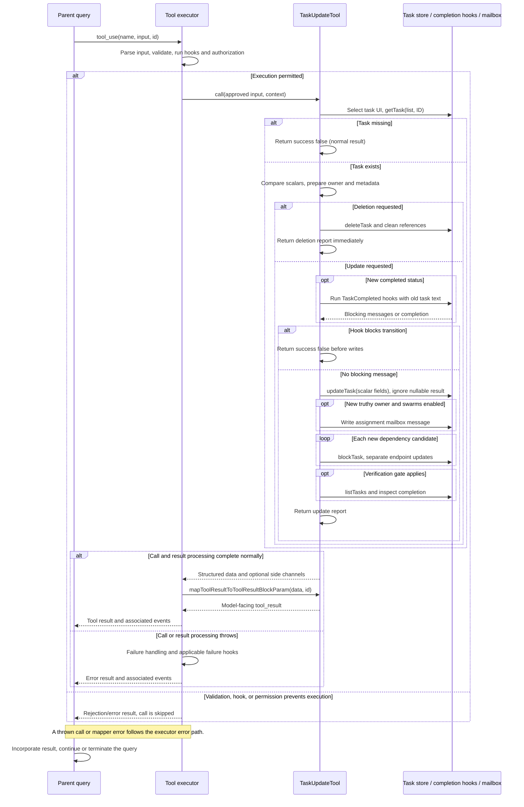

# TaskUpdateTool Internals

Source: [tools/TaskUpdateTool/TaskUpdateTool.ts](../../../../../tools/TaskUpdateTool/TaskUpdateTool.ts). Line ranges refer to this recovered source snapshot; symbols are the stable navigation handles.

## Purpose and caller boundary

Applies scalar fields, metadata edits, deletion or status transitions, ownership notifications, and dependency additions to one TodoV2 task. Strict input requires taskId; every mutation is optional. Output reports success, attempted updatedFields, optional error/statusChange, and an optional verification nudge. It is deferred and concurrency-safe but performs a sequence of separately committed operations.

The [shared invocation lifecycle](../../invocation-lifecycle.md) explains registry selection, schema validation, authorization, hooks, result mapping, and exception handling. The sequence below begins with a model tool request and ends at the parent conversation boundary; external services and background workers retain their own lifecycles.

## Source-order walkthrough

### 1. Input and output (1–86)

Subject, description, activeForm, and owner are optional strings; empty values are accepted. Status includes pending/in_progress/completed plus the special deleted operation. `addBlocks` and `addBlockedBy` contain IDs. Metadata is shallow-merged, with null meaning delete a key. The result is a report, not a fresh task record.

### 2. Registration and early UI mutation (88–143)

Registration uses the TodoV2 gate, concurrency-safe deferral, and ID/status/subject classifier text. `call` captures the list ID and selects the tasks expanded view before checking that the target exists.

### 3. Read baseline and prepare scalar updates (145–184)

A missing baseline returns success false with `Task not found` and no updated fields. Otherwise compare each supplied scalar against the baseline and collect changed fields in `updates` and `updatedFields`; nothing has been persisted yet.

### 4. Auto-ownership and metadata (185–211)

With swarms enabled, a requested in_progress status can assign the current agent when the caller omitted owner and the task lacks one. This check does not require a status transition. Supplied metadata always causes a merged metadata write and updated-field entry, even for an empty or equivalent object.

### 5. Deletion short circuit (212–227)

If status is deleted, await `deleteTask` and return immediately. Prepared scalar/metadata updates are discarded. Completion hooks, assignment mail, dependency additions, and verification logic are skipped. The store updates the high-water mark, unlinks the record, then cleans references in other files; it can return false after partial effects.

### 6. Status change and completion hooks (229–270)

Only a different requested status enters this branch. Before completion, iterate TaskCompleted hooks with the OLD subject/description, teammate identity, and abort signal. Blocking messages return success false with an empty updatedFields list, leaving all prepared changes unapplied. A thrown hook exception escapes instead. Successful hooks allow the status field into `updates`.

### 7. Commit scalar fields (272–274)

If updates is nonempty, await `updateTask` once. It locks the file, re-reads the record, merges updates, writes, and notifies watchers. The tool ignores its nullable return; concurrent deletion can therefore lead to a success report without an applied scalar update. Comparisons and merged metadata came from the earlier unlocked snapshot.

### 8. Notify a new owner (276–298)

A truthy updated owner with swarms enabled triggers assignment JSON to that owner’s mailbox, using the OLD subject and description, sender identity/color, and timestamp. It runs after the scalar write and before edges. Mailbox failure throws without rolling back the owner change.

### 9. Add outgoing and incoming edges (300–324)

Filter requested IDs against the baseline arrays, then sequentially call `blockTask` for outgoing edges and reversed arguments for incoming edges. Return booleans are ignored. A nonempty candidate list adds the field name even if endpoints were missing; duplicate input IDs are not separately deduplicated. The helper updates the two endpoint files separately and imposes no cycle/self-edge validation.

### 10. Optional verification hint (326–349)

The VERIFICATION_AGENT feature, runtime gate, root context, and newly completed status enable a list-wide check. If all tasks are completed, at least three exist, and no subject matches /verif/i, set the nudge flag. This reads all tasks, including internal ones, and launches no agent.

### 11. Structured and model results (351–406)

Return success true, collected fields, and a status change only when status was actually prepared. The mapper renders success false as ordinary text without is_error, deliberately avoiding sibling cancellation. A completed teammate task adds a TaskList reminder. Verification adds model instructions only. An empty mutation can succeed with an empty field list.

## End-to-end sequence

The success arrows after `call` describe normal completion. An exception skips normal result mapping; see the failure boundaries below. Query continuation remains subject to cancellation and turn/budget limits.

## State, failure, and cancellation boundaries

Task-list identity is resolved by `getTaskListId()` in `utils/tasks.ts`: explicit environment override, in-process teammate team, process/leader team, then session ID. Paths live under the Claude config directory's `tasks` tree, with sanitized list and task IDs. This is the persistent TodoV2 list, separate from `AppState.tasks` runtime jobs.

The store uses per-list locking for ID allocation and per-file locking for updates. Neither makes an entire tool invocation transactional. Reads return null for missing, invalid, or unreadable task records; list reads omit invalid records and can return an empty list on directory errors. Hooks receive the context abort signal where passed; ordinary file operations here do not implement transport cancellation.

There is no transaction across fields, mailbox delivery, and edges. A later throw may follow successful writes. `updatedFields` describes the tool's prepared work, not independently confirmed persistence of every edge. The tool does not use `claimTask` or compare-and-swap ownership. Completion-hook rejection returns a non-error report; exceptional hook/mailbox/storage failures go through executor exception handling. Only hook execution is explicitly passed the abort signal here.

## Related design

[Task storage](./task-storage.md) expands JSON locking and dependency helpers; [task-list overview](./task-list-tools.md) compares the CRUD contracts.
