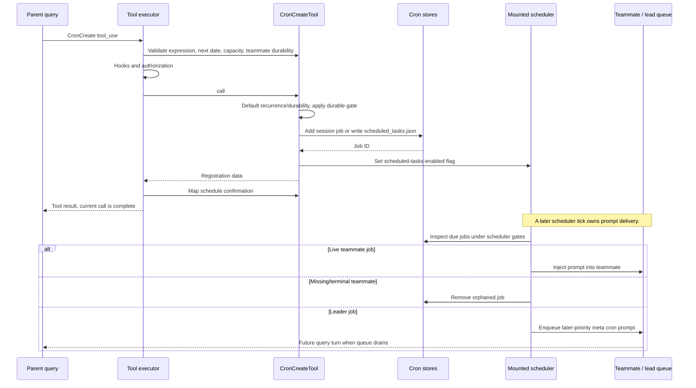

# CronCreateTool Internals

Source: [tools/ScheduleCronTool/CronCreateTool.ts](../../../../../tools/ScheduleCronTool/CronCreateTool.ts). Line ranges refer to this recovered source snapshot; symbols are the stable navigation handles.

## Purpose and caller boundary

Registers a cron-triggered prompt; it does not execute the prompt during the tool call. Strict input contains a five-field local-time cron string, prompt, and optional semantic booleans recurring/durable. Call defaults are recurring true and durable false. Registry inclusion requires AGENT_TRIGGERS, and the tool’s enablement also checks isKairosCronEnabled().

The [shared invocation lifecycle](../../invocation-lifecycle.md) explains registry selection, schema validation, authorization, hooks, result mapping, and exception handling. The sequence below begins with a model tool request and ends at the parent conversation boundary; external services and background workers retain their own lifecycles.

## Source-order walkthrough

### 1. Contract and registration (1–80)

MAX_JOBS is 50. Output contains short ID, human schedule, recurrence, and effective durability. The deferred tool retains default mutating/serial metadata, classifies cron plus prompt, and exposes the cron-file path even for an in-memory request. Description/prompt reflect the durable-cron gate.

### 2. Validation (81–115)

Reject an unparsable expression (code 1), no matching date in the next year (2), or a combined-store count of at least 50 (3). A teammate requesting durable true is rejected (4) because teammate identity does not survive restart. This is a preflight count, not an allocation lock.

### 3. Register the job (117–138)

Compute effectiveDurable as requested durable AND the current durable gate. `addCronTask` generates an eight-hex-character ID and createdAt; session-only jobs go into bootstrap state and can retain teammate agentId, while durable jobs read/append/write scheduled_tasks.json. After registration, setScheduledTasksEnabled(true) starts scheduler polling on a subsequent tick.

### 4. Result and UI (140–158)

Return cronToHuman output and effective flags. The mapper distinguishes recurring auto-expiry guidance from one-shot auto-deletion, and disk persistence from session-only lifetime. It reports registration, not prompt completion.

### 5. Later execution boundary (hooks/useScheduledTasks.ts:40–125)

The mounted hook creates a cron scheduler only when runtime enabled and stops it on cleanup. Normal fires with agentId inject into an existing nonterminal teammate; absent teammates cause orphan removal. Leader fires append a fire message and enqueue a later-priority meta prompt with cron workload attribution. Scheduler loading/jitter/kill-switch behavior is delegated to createCronScheduler.

## End-to-end sequence

The success arrows after `call` describe normal completion. An exception skips normal result mapping; see the failure boundaries below. Query continuation remains subject to cancellation and turn/budget limits.

## State, failure, and cancellation boundaries

The 50-job check can race with other registrants. Durable registration is read/append/write, not a tool-level transaction with scheduler activation. A gate flip silently downgrades durability at call time; the result reports the effective value. Cancellation does not automatically delete an already registered job. Future firing depends on a live scheduler and gates, and does not run inside this invocation.
