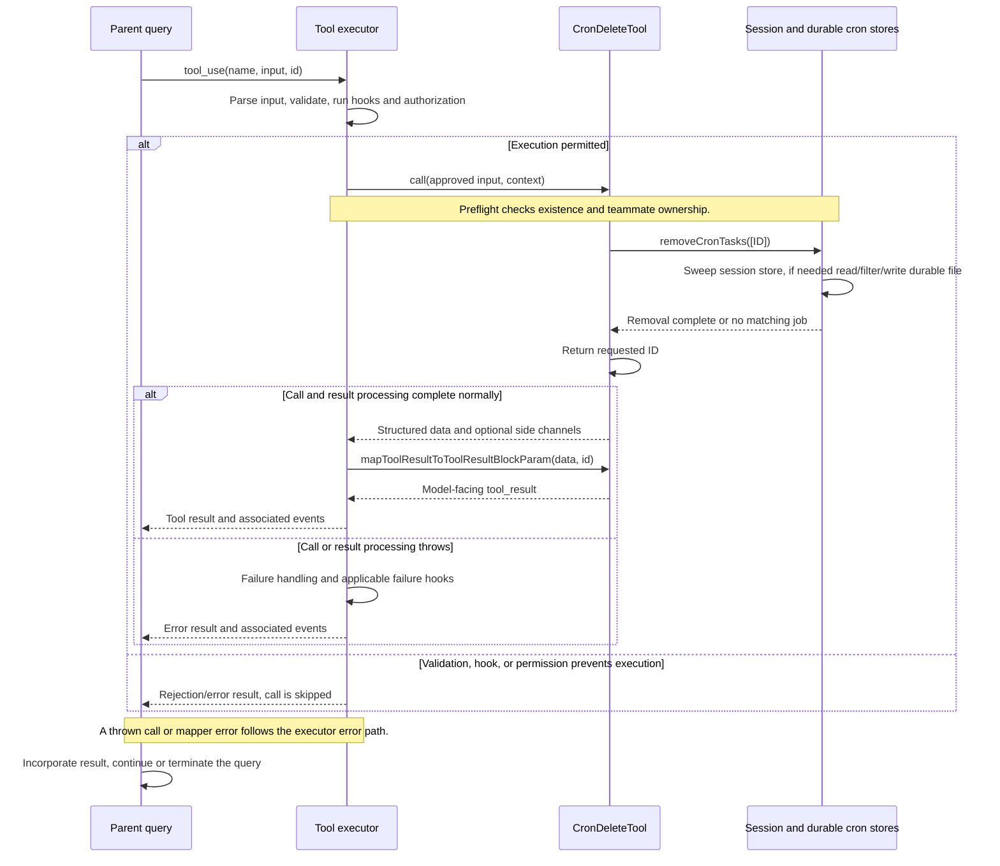

# CronDeleteTool Internals

Source: [tools/ScheduleCronTool/CronDeleteTool.ts](../../../../../tools/ScheduleCronTool/CronDeleteTool.ts). Line ranges refer to this recovered source snapshot; symbols are the stable navigation handles.

## Purpose and caller boundary

Deletes a scheduled job by strict string ID across the session and durable stores. It is deferred, mutating, and defaults to serial scheduling. It shares CronCreate’s registry/runtime gates but does not disable the scheduler when the last job is deleted.

The [shared invocation lifecycle](../../invocation-lifecycle.md) explains registry selection, schema validation, authorization, hooks, result mapping, and exception handling. The sequence below begins with a model tool request and ends at the parent conversation boundary; external services and background workers retain their own lifecycles.

## Source-order walkthrough

### 1. Contract and registration (1–61)

Output contains only the ID. Prompt reflects durable support; getPath exposes the cron-file path and classifier uses ID. UI functions are shared with the cron family.

### 2. Existence and ownership preflight (62–82)

Load all jobs and find the requested ID. Missing returns validation code 1. In teammate context, reject a job whose agentId differs with code 2. A leader without teammate context can delete any visible job. Checks happen before call and are not repeated there.

### 3. Removal (83–87)

Await removeCronTasks([id]). The helper first removes matching session jobs and returns early if all IDs were accounted for. Otherwise read durable jobs, filter IDs, and only write if something changed. Missing-at-execution is a no-op.

### 4. Result (88–96)

Return the requested ID and map it to a cancellation confirmation. There is no count or proof that an item existed when deletion executed.

## End-to-end sequence

The success arrows after `call` describe normal completion. An exception skips normal result mapping; see the failure boundaries below. Query continuation remains subject to cancellation and turn/budget limits.

## State, failure, and cancellation boundaries

Deletion can race with natural one-shot cleanup and remains a successful no-op. It removes future scheduling registration; it does not cancel a prompt already enqueued or an agent already running. Session removal may precede a failing durable write. No abort signal is passed by this tool.
