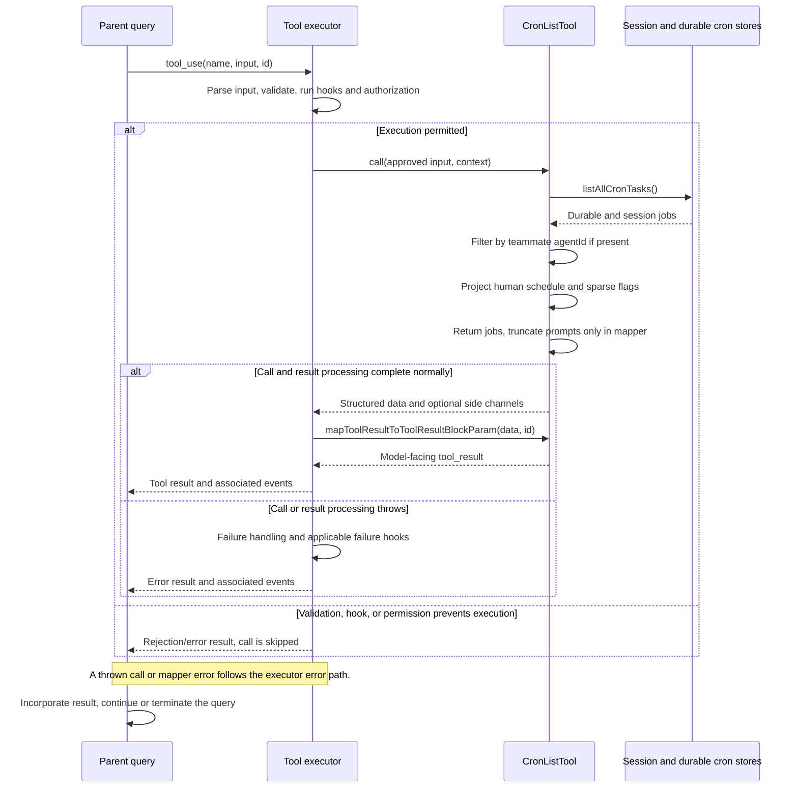

# CronListTool Internals

Source: [tools/ScheduleCronTool/CronListTool.ts](../../../../../tools/ScheduleCronTool/CronListTool.ts). Line ranges refer to this recovered source snapshot; symbols are the stable navigation handles.

## Purpose and caller boundary

Lists cron registrations from a strict empty input. Deferred, read-only, and concurrency-safe, it returns job summaries rather than scheduler execution history or next-fire timestamps.

The [shared invocation lifecycle](../../invocation-lifecycle.md) explains registry selection, schema validation, authorization, hooks, result mapping, and exception handling. The sequence below begins with a model tool request and ends at the parent conversation boundary; external services and background workers retain their own lifecycles.

## Source-order walkthrough

### 1. Schemas and metadata (1–62)

Each job carries ID, cron, humanSchedule, prompt, optional recurring and durable. Enablement and prompt gates match the family. There is no custom validator or classifier.

### 2. Scope and projection (63–79)

Read the combined store. A teammate sees only exact agentId matches; a leader sees all. Convert cron to human text. Emit recurring only when true and durable only when false, preserving the convention that omitted durability denotes the persisted form. The full prompt remains in structured data.

### 3. Mapper and UI (80–98)

Each model-facing row shows schedule, recurring/one-shot, session-only marker when false, and a prompt truncated to 80 characters. Empty output is ordinary `No scheduled jobs.` text. UI adapters consume the structured summaries.

## End-to-end sequence

The success arrows after `call` describe normal completion. An exception skips normal result mapping; see the failure boundaries below. Query continuation remains subject to cancellation and turn/budget limits.

## State, failure, and cancellation boundaries

The result is a registration snapshot and does not prove the scheduler is currently running. A missing recurring field maps to one-shot. Listing performs no job deletion, expiration, or execution itself, and does not pass an abort signal to storage.
