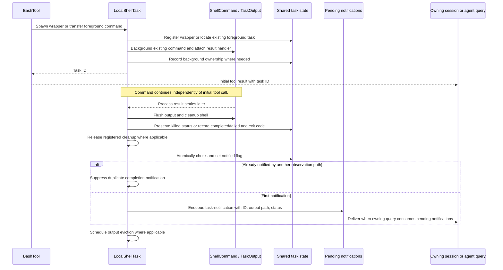

# BashTool Internals

Source: [tools/BashTool/BashTool.tsx](../../../../../tools/BashTool/BashTool.tsx). Line ranges refer to this recovered source snapshot; symbols are the stable navigation handles.

## IMHO - Overall Sequence Flow

### `mapToolResultToToolResultBlockParam`

- Structured output (Codex claim there is no place to generate this type of output in current source code)
- Image based64
- Text
  - Large size result
  - The error message appends interrupted prompt if any
  - Background information 

### `call`

- iterate`runShellCommand` generator
- For progressive results, call `onProgress` callback to render the progresses to the caller (UI)
- Process the final result
- Keep only the specified maximum length of  `stdout` to avoid the oversized outcome
- Inspect and normalize the error code and error message from the the exit code. some of non-zero exit code doesn't mean error.
- If current agent is the main agent, reset the working directory to the original one in case it has been changed by the bash execution.
- If the result contains associated output file path (result size is large),  link/copy the file to the dedicated project scope tool-result path. if the result size is larger than 64MB, truncate the file to 64MB size.
- Non-interrupted error raises the exception.
- If `stdout` is an image, resize the image with an appropriate size.
  - This is for the case where bash command output base64 based image directly.
  - For the case that persist the image into the file. LLM can use `FileReadTool` to load this image later on.

- return


### `TaskOutput`

File: `utils/task/TaskOutput.ts`

This description covers the normal Bash file-mode path; hook/pipe-mode behavior is outside its scope.

`TaskOutput` manages captured command output and progress snapshots. **`TaskOutputCapture`** could be a more explicit name. It does not itself own the command’s execution
status or exit code.

- **Construction:** The constructor receives a task ID, progress callback, capture-mode flag, and optional memory limit. It derives the output-file path from the task ID.
In Bash file mode, the child writes stdout and stderr directly into that file throughout execution.

- **Shared static fields:**
  - `#registry`: File-mode instances that have a progress callback.
  - `#activePolling`: Registered instances currently selected for polling.
  - `#pollInterval`: The handle for the single shared polling timer.

- **`startPolling(taskId)`:** Looks up the registered instance and adds it to `#activePolling`. If no timer exists, it creates a one-second interval that calls `#tick()`.
The timer is unreferenced so it cannot alone keep the application running.

- **`#tick()`:** For each active instance with a callback:
  - Starts an asynchronous `tailFile()` read of at most the last 4,096 bytes, without awaiting it.
  - When the read completes, rechecks that the callback still exists.
  - If content is empty, invokes `onProgress` with empty previews. This still wakes the Bash progress loop so it can check lifecycle changes.
  - Otherwise, scans the sample to extract short and longer previews targeting the last 5 and 100 lines.
  - Uses the sample’s line count directly when the whole file fits, or estimates the total from sample density when it does not. These are display-oriented counts, with newline-counting edge cases.
  - Updates stored counters and calls `onProgress` with previews, total lines, file size, and whether earlier bytes were omitted.
  - Ignores read failures.
  
  The previews are snapshots, not a queue of every output change. Because reads are not awaited, successive ticks can overlap.
  
- **`stopPolling(taskId)`:** Removes the instance from active polling. If no active instances remain, it clears the shared timer. Reads already in flight are not
canceled.

- **`getStdout()`:** Reads a bounded **prefix** of the output file, unlike progress polling, which reads its tail. After a successful read, it records file size and sets
  `#outputFileRedundant`:
  - `true` when the entire output fits inline.
  - `false` when additional output remains in the file.

  Downstream shell/tool code uses this information to delete redundant files or preserve larger output and expose its location.

### `ShellCommandImpl`

File: `utils/ShellCommand.ts`

This description covers the normal Bash file-mode path; hook/pipe-mode behavior is outside its scope.

`ShellCommandImpl` **manages an already-spawned shell process: completion, cancellation, timeout, backgrounding, and final result assembly.** `Shell.exec()` launches the
process first, then `wrapSpawn()` constructs this wrapper.

**Construction:** The constructor receives the child process, abort signal, timeout, `TaskOutput`, optional automatic-backgrounding flag, and optional output-size limit.
It stores these dependencies and creates the public `result` Promise. Bash stdout and stderr already point to the output file, so no JavaScript stream wrappers are created in this mode.

**Important instance fields:**

- `#status`: Initially `running`; can become `backgrounded`, `completed`, or `killed`.
- `#backgroundTaskId`: Identifies the task that owns the backgrounded command.
- `#childProcess`: The process handle supplied by `Shell.exec()`.
- `taskOutput`: Captures output and supplies progress previews and final output.
- `#timeoutId`: Handle for the foreground execution timeout.
- `#sizeWatchdog`: Handle for periodic background-output size checks.
- `#exitCodeResolver`: Completes the internal Promise carrying the exit-code number.
- `#resultResolver`: Completes the public `result` Promise carrying the full `ExecResult`.
- `#boundAbortHandler`: Saved callback reference, allowing the abort listener to be removed later.
- `#onTimeoutCallback`: Optional callback registered by the caller to handle timeout through backgrounding.

**`#createResultPromise()`:** Installs lifecycle listeners and constructs two connected Promises.

- Registers a one-time abort listener.
- Registers one-time child-process `exit` and `error` listeners.
- Starts the foreground timeout.
- Creates `exitPromise`, saving its resolver in `#exitCodeResolver`.
- Creates the public result Promise, saving its resolver in `#resultResolver`.
- Registers `#handleExit` through `exitPromise.then(...)`.

The process event resolves `exitPromise` with a number. `#handleExit(code)` then reads the output, builds `ExecResult`, and resolves the public result Promise.

The implementation listens for `exit`, not `close`, so completion does not wait for descendant processes to close inherited output descriptors.

**`#exitHandler(code, signal)`:** Converts the process exit event into a numeric result and calls `#resolveExitCode()`.

- Uses the supplied exit code when available.
- If there is no exit code and the signal is `SIGTERM`, maps it to `144`, Otherwise falls back to `1`.

The `144` mapping is the current implementation’s behavior, distinct from its internal timeout code of `143`.

**`#errorHandler()`:** Calls `#resolveExitCode(1)` when the child process emits an error.

**`#resolveExitCode(code)`:** Calls the saved exit-Promise resolver, then clears the reference. Later exit/error/kill paths cannot resolve it again. The first path that
reaches this method with an available resolver determines the result code.

**`#handleExit(code)`:** Assembles the final command result.

- Clears lifecycle timers and removes the abort listener.
- Changes `running` or `backgrounded` status to `completed`; preserves `killed`.
- Awaits `taskOutput.getStdout()`.
- Builds `ExecResult` with the code, stdout, stderr, interruption flag, and optional background task ID.
- For foreground output that fits entirely inline, requests deletion of the redundant output file.
- For larger foreground output, includes the file path, size, and task ID.
- Keeps background output files for later task consumption.
- Adds a diagnostic for output-size termination or timeout when applicable.
- Resolves the public `result` Promise.

`completed` means execution has finished, not necessarily succeeded. A nonzero code can still have this wrapper status; higher layers interpret success or failure.

**`#abortHandler()`:** If the abort reason is `'interrupt'` (user submitted a new message), returns without killing the process, leaving the caller an opportunity to background it. Other abort reasons call `kill()`.

This handler does not itself perform backgrounding.

**`onTimeout(callback)`:** Available when automatic backgrounding is enabled. Calling it stores the supplied callback; it does not invoke it immediately.  (assign `#onTimeoutCallback` to `startBackgrounding` in `BashTool.tsx line 1036`

**`#handleTimeout(self)`:** Runs when the foreground timeout expires.

- If automatic backgrounding is enabled and a callback is registered, invokes that `#onTimeoutCallback` with `self.background.bind(self)`.
- Otherwise calls `#doKill(143)`.

The callback receives the bound `background()` method and can call it after arranging task ownership.

**`background(taskId)`:** Transitions a running command into background execution.

- Returns `false` if the command is no longer `running`.
- Records the background task ID and changes status to `backgrounded`.
- Removes the foreground timeout and abort listener.
- Starts the file-size watchdog.
- Returns `true`.
- The primary purpose of this function is to clean up the foreground related resources, start file-size watchdog for background,  and set status as `background`.

It does not spawn another process, move output to another file, or resolve the command’s result Promise. The existing child continues writing to the same output file. The
higher-level caller can return a background-task handle while the command continues. (we will talk more later on)

**`#startSizeWatchdog()`:** Every five seconds, asynchronously checks the output-file size. If the command is still backgrounded and the file exceeds the configured limit
—5 GiB by default—it marks the size-limit condition and calls `#doKill(137)`.

The timer is unreferenced so it cannot alone keep the application running. Failed size checks are ignored. Because enforcement is periodic, the file can exceed the limit
before termination occurs.

**`kill()` and `#doKill(code)`:** Mark the command as killed, request `SIGKILL` for the process tree when a PID exists, and resolve the internal exit Promise immediately.

The supplied numeric code classifies the result; it does not select the OS signal:

- Normal `kill()` uses result code `137`.
- Timeout uses result code `143`.
- Output-size termination uses result code `137`.
- All these paths request the OS signal `SIGKILL`.

Because the resolver is called immediately, result assembly does not wait for a subsequent process-exit event. `ExecResult.interrupted` is calculated as `code === 137`.

**`#cleanupListeners()`:** Clears the timeout and size watchdog and removes the saved abort listener. It deliberately leaves the process `exit` and `error` listeners installed so they can still complete the result.

**`cleanup()`:** Clears `TaskOutput` resources, removes lifecycle timers/listeners, and releases references to the child process, abort signal, and timeout callback.

Cleanup is separate from termination: it does not itself kill the child or automatically delete its output file. The owner should call it when execution ownership and
output handling have finished.

### `runShellCommand`

#### Overall flow

- Define a `createProgressSignal` function which activates `race` function so that we can yield updated progress events.
- call `exec` function that prepares and launches a new shell process, connects output capture, and returns a `ShellCommand` handle for managing its lifecycle. It does not wait for the command to finish.
- Set up auto-backgrounding callback on timeout of `ShellCommandImpl` if enabled
- If the caller requires run shell in background, call `spawnBackgroundTask` and return
- Race result and `PROGRESS_THRESHOLD_MS(2s)` so that it gives us a chance to get the result without polling the task output file.
- Start polling `TaskOutput`
- loop for `Promise.race([resultPromise, progressSignal]` to get either progress events or final result.
- any type of return from loop will finally stop polling `TaskOutput`.

#### `createProgressSignal`

- Define a `createProgressSignal` function that returns a promise resolving to `null`. Calling its `resolve` function is similar to calling `set_result` on a Python `Future`.

  - When the underlying `exec` function runs, create an associated signal to wake the progress-processing loop. At line 1036, the loop waits for either the final result or a progress signal:

    ```python
    const result = await Promise.race([resultPromise, progressSignal]);
    ```

  - The underlying `exec` function’s `onProgress` callback resolves any pending progress signal and clears the reference to it. This resumes the loop at line 1036, allowing it to yield the latest progress event.

  - This approach adapts a regular function with progress callbacks into an asynchronous generator, similar to `streamedCheckPermissionsAndCallTool` at line 492 in `toolExecution.js`. The main difference is that this approach retains only the latest progress event, whereas the latter queues all progress events.


#### `exec`

File: `utils/Shell.ts`

This description covers the normal Bash file-mode path; hook/pipe-mode behavior is outside its scope.

`exec()` **prepares and launches a new shell process, connects output capture, and returns a `ShellCommand` handle for managing its lifecycle. It does not wait for the command to finish.**

**Parameters:**

- `command`: The shell command to execute.
- `abortSignal`: Signal used to manage cancellation.
- `shellType`: Selects the Bash or PowerShell provider.
- `options`: Optional timeout, progress callback, cwd policy, sandbox flag, automatic-backgrounding flag, and stdout callback.

**Return value:** `Promise<ShellCommand>`. Awaiting `exec()` waits for setup and launch. Awaiting the returned handle’s `result` waits for the command result.

**Select the shell provider:** Resolves the provider for the requested shell type. The provider supplies the shell executable, command construction, launch arguments, and
environment overrides.

**Build the command script:** Calls `provider.buildExecCommand()`. For Bash, this prepares snapshot/environment setup, command evaluation, stdin handling, and **a command that writes the final working directory into a temporary cwd file.**

The cwd file is separate from the task output file.

- **The cwd file records the shell’s final working directory,** so Claude Code can use that directory for subsequent commands.
-   The generated script therefore appends: `pwd -P >| /tmp/claude-<id>-cwd`


**Validate the working directory:** Checks whether the current directory still exists. If unavailable, attempts to fall back to the original working directory. If neither directory is available, returns a failed-command handle.

**Check cancellation:** If the abort signal is already aborted at the pre-spawn check, returns an aborted-command handle without launching the shell.

**Apply optional sandboxing:** If `shouldUseSandbox` is enabled, wraps the prepared command through `SandboxManager.wrapWithSandbox()` and attempts to create the sandbox
temporary directory.

`exec()` itself does not perform the tool permission-approval interaction.

**Prepare output capture:**

- Generates a task ID.
- Creates a `TaskOutput` instance.
- Creates the output directory.
- Opens the task output file.
- Configures child stdout and stderr to write to the same file.

The child writes directly to that file through its inherited file descriptors. JavaScript does not receive and persist each output chunk in this mode.

**Launch the process:** Calls `spawn()` with the shell executable, prepared arguments, environment, working directory, and stdio configuration.

This is where process execution is initiated. Each invocation creates a new shell process.

**Attach lifecycle management:** Calls `wrapSpawn()` to construct `ShellCommandImpl`, passing the child process, abort signal, timeout, `TaskOutput`, and automatic-
backgrounding flag.

`ShellCommandImpl` manages completion, cancellation, timeout, background-state transitions, and background output-size monitoring.

The parent then closes its own output-file handle. The child retains its inherited descriptors and continues writing.

**Register completion-side cleanup:** Attaches a callback to `shellCommand.result` `void shellCommand.result.then(async result => {...}` that later: 

- Performs sandbox cleanup when applicable.
- Reads the cwd file and updates application cwd when cwd changes are allowed and the command was not backgrounded.
- Invalidates the session environment cache if cwd changed.
- Deletes the temporary cwd file.

Registering this callback does not wait for command completion. This cleanup does not delete the task output file.

**Return the handle:** Returns `shellCommand`, potentially while the child process is still running.

**The two completion boundaries:**

- `await exec(...)`: Wait for command preparation, process launch, and wrapper setup.
- `await shellCommand.result`: Wait for the lifecycle wrapper to produce the command result.

**Responsibility boundaries:**

- `BashTool.runShellCommand()`: Foreground/background orchestration and progress delivery.
- `exec()`: Command preparation, process launch, and component setup.
- Child process: Actual command execution.
- `TaskOutput`: Output capture, progress snapshots, and output retrieval.
- `ShellCommandImpl`: Process lifecycle management and result assembly.

**Error handling:** Several failures produce special command handles, including an unavailable working directory, an already-aborted signal, and errors caught in the spawn/setup region.

Not every setup failure is converted into a command result. Operations before the spawn-region `try`, such as provider setup or opening the output file, can reject the `exec()` Promise directly.

#### `startBackgrounding()`

File: `tools/BashTool/BashTool.tsx`
Location: Lines 924–963, nested inside `runShellCommand()`.

This description covers the normal Bash file-mode path.

`startBackgrounding()` **arranges background ownership for an already-running shell command and records its task ID so the Bash generator can return control.**

It chooses between converting an existing foreground task in place and registering a new background task for the existing subprocess.

**IMHO, the complexity is caused by the late foreground task registration occurring at the progress loop phase, while maybe improving a bit of performance, it introduce additional complexity of approaching transition. we could register the associated task when creating a sub process, and then always update registered task to conveying the background transition.**

**Parameters:**

- `eventName`: Analytics event name identifying the backgrounding trigger.
- `backgroundFn`: Optional callback receiving the background task ID. The timeout path supplies the shell wrapper’s bound `background()` method.

**Return value:** `void`.

The function does not return a task ID, expose a completion Promise, or wait for subprocess completion. It communicates the background task ID through the enclosing
`backgroundShellId` variable.

**Captured context:** As a nested function, it accesses the current invocation’s:

- `foregroundTaskId`: Existing foreground task registration, if present.
- `shellCommand`: Wrapper for the running subprocess.
- `command` and `description`: Command text and task description.
- `setAppState` and `toolUseId`: Task-state update channel and originating tool invocation.
- `spawnBackgroundTask()`: Helper that registers background ownership.
- `resolveProgress`: Resolver used to wake the generator’s progress wait.

**When it is called:**

The current implementation has two direct callers:

- **Command timeout:** When `shellCommand.onTimeout` exists and `shouldAutoBackground` is true, the timeout handler calls this function with event name
`tengu_bash_command_timeout_backgrounded` and the supplied `backgroundFn`.
- **Assistant blocking budget:** After 15 seconds, an enabled and active KAIROS main-thread invocation calls it with event name
`tengu_bash_command_assistant_auto_backgrounded`, provided background tasks are enabled, explicit background execution was not requested, and the shell is still running
without a recorded background ID.

The assistant timer sets `assistantAutoBackgrounded = true` before calling this function.

The command allowlist check used by timeout backgrounding is not part of the assistant timer’s condition. Consequently, the assistant timer can background a command that
timeout-driven backgrounding would exclude.

Explicit `run_in_background: true` calls `spawnBackgroundTask()` directly. Manual Ctrl+B backgrounding follows a separate task-management path.

**Existing foreground task branch:** First checks whether `foregroundTaskId` is present.

A foreground task can have been registered by the generator’s progress loop when the background hint becomes available. Foreground registration means the command already
has application task bookkeeping even though its execution is still blocking the tool invocation.

If the ID exists, this function calls:

```ts
backgroundExistingForegroundTask(
  foregroundTaskId,
  shellCommand,
  description || command,
  setAppState,
  toolUseId
)
```

That helper transitions the shell wrapper, updates the existing task’s background flag, starts its stall watchdog, and attaches completion handling.

Reusing the registration avoids overwriting the task record, emitting another task-start event, or creating another shutdown-cleanup registration.

**If the transition fails:** When `backgroundExistingForegroundTask()` returns `false`, `startBackgrounding()` immediately returns.

It does not assign `backgroundShellId`, log the backgrounding event, or invoke `backgroundFn`.

The helper’s Boolean confirms the shell-wrapper transition; it does not independently guarantee that the application task entry was updated.

**If the transition succeeds:** The function:

1. Assigns `foregroundTaskId` to `backgroundShellId`.
2. Logs `eventName` with `command_type`.
3. Invokes `backgroundFn(foregroundTaskId)` when supplied.
4. Returns.

This branch does not explicitly resolve `resolveProgress`. A subsequent progress callback normally wakes the generator so it can observe `backgroundShellId`.

**No existing foreground task branch:** If `foregroundTaskId` is absent, the function starts:

```ts
void spawnBackgroundTask().then(shellId => {
  // Record the ID, wake progress, log, and invoke the callback.
})
```

`spawnBackgroundTask()` calls `spawnShellTask()` with the existing `shellCommand`, command description, tool-use ID, and agent ID.

Despite the helper names, this path does not launch another subprocess. It registers a background task around the already-running shell.

The registered task ID comes from `shellCommand.taskOutput.taskId`, preserving the association between the task and its output file.

The underlying registration and transition work occurs without an internal `await` in `spawnShellTask()`, but this function’s `.then()` callback still runs
asynchronously.

**After background registration resolves:** The callback:

1. Stores the returned ID in `backgroundShellId`.
2. Captures `resolveProgress`.
3. If a resolver exists, clears `resolveProgress` and invokes the captured resolver.
4. Logs `eventName` with `command_type`.
5. Invokes `backgroundFn(shellId)` when supplied.

The ID is stored before the progress signal is resolved, so the resumed generator can observe the background state.

**Overall flow:**

1. Receive a backgrounding trigger and optional callback.
2. Check whether a foreground task is already registered.
3. Convert that task in place, or register background ownership for the existing shell.
4. Record the background task ID.
5. Explicitly wake the progress wait in the new-registration branch.
6. Log the trigger and invoke the optional callback.
7. Let the generator return a background-task result, unless command completion wins.
8. Let task completion handling later perform cleanup, state updates, and notification delivery.

#### `spawnShellTask()`

File: `tasks/LocalShellTask/LocalShellTask.tsx`

This description covers the normal Bash file-mode path; hook/pipe-mode behavior is outside its scope.

`spawnShellTask()` **registers an already-running shell command as a background task and installs its completion handling.** Despite its name, it does not spawn another subprocess. The existing process was launched earlier by `Shell.exec()`.

**Parameters:**

- `input`: Command text, description, existing `shellCommand`, optional tool-use ID, agent ID, and task kind.
- `context`: Application context. This function directly uses `setAppState` to register and update task state.

**Return value:** `Promise<TaskHandle>`, containing the task ID and a cleanup-registration removal function.

Awaiting `spawnShellTask()` waits for task setup, not for the subprocess to finish. The function registers completion callbacks and returns the handle while execution
continues.

**Reuse the existing task ID:** Reads `shellCommand.taskOutput.taskId`. This keeps the registered task ID consistent with the existing output file. It does not generate a
new process or output file.

**Register shutdown cleanup:** Calls `registerCleanup()` with a callback that invokes `killTask(taskId, setAppState)`.

This allows application cleanup (when graceful shutdown) to stop the background task. The returned `unregisterCleanup` function removes this cleanup registration when called.

**Construct the task state:** Creates a `LocalShellTaskState` using `createTaskStateBase()` and additional shell-specific fields.

- `status: 'running'`: The command is still executing.
- `isBackgrounded: true`: The command is managed as a background task.
- `command`: The original command text.
- `shellCommand`: The existing process-management handle.
- `unregisterCleanup`: The function that removes the shutdown cleanup registration.
- `agentId`: Optional association with the agent that owns the task.
- `kind`: Optional task presentation variant.
- Additional fields track output reporting and notification bookkeeping.

The task's `status` and `isBackgrounded` describe different things. A command can be both running and backgrounded.

**Register the task:** Calls `registerTask(taskState, setAppState)`.

This adds the task to `AppState.tasks[taskId]`. For a newly registered ID, `registerTask()` also enqueues an SDK `task_started` event, subject to the SDK queue's delivery policy.

**Transition the shell wrapper:** Calls `shellCommand.background(taskId)`.

For Bash, this records the background task ID, changes the wrapper status to `backgrounded`, removes the foreground timeout and abort listener, and starts the output-file size watchdog.

The same child process continues writing to the same output file. Its result Promise remains pending until completion or termination.

The current function does not inspect the Boolean return value of `background()`, so this call alone does not guarantee that a transition occurred if the process has already finished.

**Start the stall watchdog:** Calls `startStallWatchdog()` and saves its cancellation function.

This watchdog checks for prolonged inactivity and output suggesting that the command is waiting for interactive input. It is separate from the output-file size watchdog managed by `ShellCommandImpl`.

**Register completion handling:** Attaches an asynchronous callback through `shellCommand.result.then(...)`.

The callback is registered immediately but executes only after the existing command's result Promise resolves. The surrounding `void` discards the Promise returned by
`.then()`; it does not wait for completion.

**When the command completes, the registered callback:**

- Cancels the stall watchdog.
- Calls `flushAndCleanup(shellCommand)` to flush captured output and clean up the shell wrapper.
- Updates the task through `updateTaskState()`.
- Preserves the task state if it was already marked `killed`.
- Otherwise sets status to `completed` when the exit code is zero, or `failed` when it is nonzero.
- Stores the exit code and interruption flag.
- Clears the task's `shellCommand` reference and stored `unregisterCleanup` field.
- Records the completion timestamp.
- Calls `enqueueShellNotification()` with the final status and exit code.
- Calls `evictTaskOutput(taskId)` without waiting for it.

Clearing the stored `unregisterCleanup` field is not the same as invoking that function. In this completion branch, the function is not explicitly called.

**Completion notification:** `enqueueShellNotification()` checks notification bookkeeping before enqueueing a message. The notification includes the task ID, output-file path, status, and summary. It does not embed the complete command output.

The addressed main or agent loop can later consume the notification and read the output file when needed.

**Output eviction:** `evictTaskOutput()` flushes and removes a map-backed disk writer if one exists. It does not delete the output file. Normal Bash file-mode output is written directly by the child process, so there may be no map-backed writer to evict.

**Return the task handle:** After setup, the function returns an object containing `taskId` and `cleanup`.

The returned `cleanup()` invokes `unregisterCleanup()`. It removes the shutdown cleanup registration; it does not itself kill the process, remove task state, or delete output.

**Foreground handoff boundary:** `spawnShellTask()` does not resolve the Bash generator's progress signal or return the foreground tool result. The higher-level
`spawnBackgroundTask()` and `startBackgrounding()` logic handles that handoff.

**Overall flow:**

1. Receive the existing shell process wrapper.
2. Reuse its output/task ID.
3. Register shutdown cleanup.
4. Create and register background task state.
5. Transition the shell wrapper to background mode.
6. Start the stall watchdog.
7. Attach the eventual completion callback.
8. Return the task handle.
9. Later, process completion triggers state updates and notification delivery.

#### `backgroundExistingForegroundTask()`

File: `tasks/LocalShellTask/LocalShellTask.tsx`

This description covers the normal Bash file-mode path.

`backgroundExistingForegroundTask()` **converts an already-registered foreground shell task into a background task.** It reuses the existing task ID, subprocess, shell
wrapper, and output file.

**Unlike `spawnShellTask()`, it updates the existing task record rather than registering a new one.** This avoids replacing task bookkeeping, emitting another task-start
event, or creating another shutdown cleanup registration.

**Parameters:**

- `taskId`: ID of the existing foreground task.
- `shellCommand`: Wrapper for the already-running subprocess.
- `description`: Description used by watchdog and completion notifications.
- `setAppState`: Updates the application's task state.
- `toolUseId`: Optional identifier associating the task with its originating tool invocation.

**Return value:** A Boolean. The function returns synchronously after arranging background ownership and completion handling. It does not wait for subprocess completion.

**Transition the shell wrapper:** First calls `shellCommand.background(taskId)`.

If that call returns `false`, this function immediately returns `false`. This normally means the shell wrapper is no longer in the `running` state.

For Bash, a successful transition records the background task ID, changes wrapper status to `backgrounded`, removes foreground timeout/abort handling, and starts the output-file size watchdog.

**Update the existing application task:** Calls `setAppState()` and looks up `prev.tasks[taskId]`.

If the entry is a local shell task and is not already backgrounded, the updater:

- Captures its `agentId` for notification routing.
- Preserves its existing fields.
- Changes `isBackgrounded` to `true`.

The application task's status remains `running`; backgrounding does not mean execution has completed.

If the entry is missing, is not a local shell task, or is already backgrounded, the updater returns the unchanged application state.

The current implementation does not return failure for those state-update no-op cases. Once `shellCommand.background()` succeeds, the function continues and eventually
returns `true`. Therefore, its return value confirms the wrapper transition, not independent validation of the application task entry.

**Start the stall watchdog:** Calls `startStallWatchdog()` and saves its cancellation function.

This watchdog detects prolonged output inactivity combined with text suggesting an interactive prompt. It sends a notification rather than terminating the command.

The task-kind argument is `undefined`, which does not disable this watchdog. The output-file size watchdog was already started separately by `shellCommand.background()`.

**Register completion handling:** Attaches an asynchronous callback through `shellCommand.result.then(...)`.

The callback observes the existing command's result Promise. It does not start another process or restart execution. The surrounding `void` discards the Promise returned
by `.then()` without waiting for completion.

**When the command completes, the registered callback:**

- Cancels the stall watchdog.
- Awaits `flushAndCleanup(shellCommand)`.
- Updates the existing task through `updateTaskState()`.
- Preserves the task if it was already marked `killed`.
- Otherwise records `completed` for exit code zero or `failed` for a nonzero exit code.
- Stores the exit code and interruption flag.
- Clears the task's `shellCommand` reference.
- Captures and clears the stored shutdown-cleanup registration.
- Records `endTime`.
- Invokes the captured cleanup-removal function outside the state updater.
- Calls `enqueueShellNotification()` with the final status and exit code.
- Starts `evictTaskOutput(taskId)` without awaiting it.

In the already-killed branch, the updater returns the existing task before capturing its cleanup-removal function. Cleanup for that branch therefore depends on the kill
path.

**Output and resource cleanup:** `flushAndCleanup()` awaits `shellCommand.taskOutput.flush()` and calls `shellCommand.cleanup()`, logging errors if they occur.

For Bash file mode, flushing does not control the child's direct file-descriptor writes. Shell cleanup clears capture resources and lifecycle listeners. It does not
automatically delete the background output file.

`evictTaskOutput()` removes a map-backed disk writer if one exists, while preserving its output file.

**Completion notification:** `enqueueShellNotification()` checks notification bookkeeping to avoid duplicate delivery. When eligible, it queues a task notification
containing the task ID, output-file path, terminal status, and summary.

The captured `agentId` routes the notification to the owning agent; an undefined agent ID addresses the main loop.

The notification references the output file rather than embedding the entire command output.

**Return after setup:** After installing the completion callback, the function returns `true`. The child process can continue running independently.

**Foreground wake-up is handled elsewhere:** This function does not resolve the Bash generator's progress signal.

Its caller, `startBackgrounding()`, records the ID in `backgroundShellId`. In the existing-foreground branch, a later progress callback normally wakes the generator's
`Promise.race()`. The generator then sees the background state and returns a background-task result.

Actual process completion is handled later by the callback registered here.

**Overall flow:**

1. Receive the existing foreground task and shell wrapper.
2. Transition the wrapper to background mode.
3. Update the existing task's `isBackgrounded` field.
4. Start the interactive-stall watchdog.
5. Register completion handling on the existing result Promise.
6. Return `true` without awaiting process completion.
7. The higher-level caller completes the foreground handoff.
8. Later, process completion triggers cleanup, task-state updates, and notification delivery.

## Purpose and caller boundary

Executes a Bash command or applies an internal approved sed preview, streams progress, and returns either completion data or a background-task handle. Model input is strict command plus optional timeout/description/background/sandbox override. The internal _simulatedSedEdit field is excluded from the model schema. Concurrency safety depends on read-only command analysis; UI search/read classification is a separate heuristic.

The [shared invocation lifecycle](../../invocation-lifecycle.md) explains registry selection, schema validation, authorization, hooks, result mapping, and exception handling. The sequence below begins with a model tool request and ends at the parent conversation boundary; external services and background workers retain their own lifecycles.


## Source-order walkthrough

### 1. Imports and UI classification (1–171)

Dependencies cover shell/security parsing, permissions, task ownership, output storage, sed/history, sandboxing, image handling, hints, and telemetry. isSearchOrReadBashCommand splits operators, skips redirect targets/operators and neutral commands, and requires every remaining command to belong to search/read/list sets. Parse failure/neutral-only returns all false. This controls collapse labels, not permission.

### 2. Silent-command heuristic (173–220)

isSilentBashCommand requires at least one nonfallback command and all such commands in a silent set. Neutral fallback after || is ignored, while other unsupported commands make it false. The result selects Done versus No output UI, not command success semantics.

### 3. Background gate, schemas, and logging classifier (222–296)

Read CLAUDE_CODE_DISABLE_BACKGROUND_TASKS at module load because it changes schema exposure. fullInputSchema includes internal sed preview; public schema always omits it and conditionally omits run_in_background. Timeout is a semantic number without a max refinement here. getCommandTypeForLogging recognizes common background executables. Output includes streams, interruption, background cause, images/structured content, semantic result text, and persisted-output metadata.

### 4. Delay helpers (298–344)

isAutobackgroundingAllowed compares the first split subcommand with the disallowed sleep entry. detectBlockedSleepPattern separately recognizes leading integer sleep >=2 seconds, including a following command, while fractional/sub-two-second pacing is not blocked. Do not equate this shallow helper with a complete shell parse.

### 5. Approved sed write helper (346–410)

applySedEdit expands target, detects encoding, reads original content, and returns normal stderr text if that read reports ENOENT. It optionally snapshots history, preserves detected line endings, writes approved newContent directly, notifies VSCode, and updates full read state. It does not run sed or repeat FileEdit’s stale-content validation. The preview field’s trust comes from permission UI injection.

### 6. Metadata, read-only scheduling, hook matcher (412–489)

isReadOnly combines commandHasAnyCd and checkReadOnlyConstraints; isConcurrencySafe delegates to it. preparePermissionMatcher uses parseForSecurity: unavailable/complex parsing matches all rules to avoid skipping a hook. Simple commands strip leading assignments via argv and match any subcommand by prefix or wildcard. UI names sed edits like file edits and conditionally shows sandbox indicator; summary prefers supplied description.

### 7. Validation and authorization (491–554)

With MONITOR_TOOL and background enabled, a nonbackground blocked sleep gets validation code 10. Other input passes this validator. bashToolHasPermission owns detailed command/path/sandbox permission logic. UI/search extraction displays stdout/stderr only; model wrappers and background path text are separate.

### 8. Model mapper (555–622)

Structured content wins, then valid image data. Otherwise trim leading blank lines/end whitespace, wrap persisted-output preview if a path exists, append stderr and interrupted error text, and add explicit/manual/assistant-budget background guidance. Text is_error equals interrupted; ordinary nonzero command failures normally threw earlier. The early structured/image branches do not run that final interrupted flag assignment.

### 9. Call entry and generator consumption (624–690)

Internal sed preview returns immediately through applySedEdit. Otherwise allocate a bounded stdout accumulator and determine main versus agent context; agents prevent cwd changes. Consume runShellCommand manually with next(), forwarding yielded progress with synthetic IDs and capturing the generator RETURN ExecResult. Background task registration uses setAppStateForTasks when available.

### 10. Semantic exit handling (692–735)

Track git operations, identify user interrupt only when result.interrupted and signal.reason is interrupt, append merged stdout/stderr, and interpret exit status. Log index.lock diagnostics. Root calls reset cwd if outside permitted project context. Annotate sandbox failures; preSpawnError throws directly, and semantic errors throw ShellError unless it was a user interrupt. finally clears tool JSX even when this region throws.

### 11. Large-output preservation (737–763)

After successful/interrupt return, if output path/task ID exist, stat and remember ORIGINAL size, ensure result directory, truncate the SOURCE file to 64 MiB when necessary, then hard-link it or copy as fallback. Any failure is swallowed so inline preview remains usable. Source truncation precedes linking, despite comments describing copying first.

### 12. Hints, images, data (765–823)

Log command/indexing metrics, strip empty lines, extract/strip Claude hint tags unconditionally, and record recommendations only for root. Detect/resize image output; failed parse/resize classification falls back to text. Return output, reset-cwd stderr, semantic note, silent-command hint, background cause, sandbox override, and persistence metadata. Terminal truncation checks stdout/stderr.

### 13. Generator contract and exec (825–909)

runShellCommand yields progress and returns ExecResult. Choose timeout with timeout || default (no local maximum clamp), initialize latest output counters and a wakeable progress promise, derive auto-background eligibility, and await exec(command, signal, bash, options). onProgress snapshots output/counts and wakes the generator; exec chooses provider, sandbox, cwd handling, and ShellCommand ownership.

### 14. Task transfer helpers (911–967)

spawnBackgroundTask wraps the existing ShellCommand using its TaskOutput ID and shared state setter. startBackgrounding converts an already registered foreground task in place, avoiding duplicate registration/cleanup events; otherwise asynchronously spawns a wrapper, stores its ID, wakes the progress race, and invokes optional timeout continuation. It does not spawn the command a second time.

### 15. Timeout/assistant/explicit background (969–1009)

Register an onTimeout callback only when eligible. The KAIROS root 15-second unref timer is a separate condition and does not consult the sleep eligibility helper. Explicit background is honored for any command type when enabled and returns synthetic code-zero, noninterrupted output with task ID. That result means work continues.

### 16. Initial wait and progress lifecycle (1011–1050)

Race process completion against a two-second unref timer. Fast completion cleans ShellCommand and returns immediately. Already backgrounded returns its handle. Otherwise start TaskOutput polling; each loop races process result against the poller-driven wake signal.

### 17. Completion/background race (1052–1095)

If a completed result still has backgroundTaskId, mark the task notified, strip that ID, restore large-output file metadata when applicable, clean the shell, and return a completed result. Normal foreground completion unregisters its foreground entry then cleans. This avoids returning a running label and redundant completion notice after the process already exited.

### 18. Running background/progress return (1097–1143)

If backgroundShellId is set, return handle; if foreground task status became backgrounded via Ctrl+B, return manual-background metadata. Otherwise register foreground task once when eligible/UI available, show BackgroundHint, and yield output/timing/counts. finally stops polling. Background ShellCommand cleanup belongs to LocalShellTask; this generator’s finally itself only stops polling.

## End-to-end sequence

This sequence expands the components outlined in **IMHO - Overall Sequence Flow**. It follows the normal Bash file-mode path: `call()` consumes the `runShellCommand()` generator; `Shell.exec()` creates the process, `TaskOutput`, and `ShellCommandImpl`; task helpers arrange background ownership. The approved sed-preview shortcut bypasses this shell lifecycle and returns through `applySedEdit()`.

The parallel branches below distinguish process completion from foreground orchestration. They share the same `shellCommand.result` Promise: the cwd callback, generator wait, and selected background-completion callback are independent observers. Backgrounding keeps the existing subprocess and output file.

```mermaid
sequenceDiagram
    autonumber
    participant E as Tool executor / owning query
    participant T as BashTool.call / result mapper
    participant G as runShellCommand generator
    participant X as Shell.exec
    participant P as Child shell process
    participant S as ShellCommandImpl
    participant O as TaskOutput
    participant L as LocalShellTask helpers
    participant U as BackgroundHint / keyboard

    E->>E: Parse input, validate, run hooks and authorize
    alt Execution prevented
        E->>E: Return rejection/error without calling BashTool.call
    else Execution permitted
        E->>T: call(approved input, context, onProgress)
        alt Internal approved sed preview
            T->>T: applySedEdit(), update file/editor/read state
        else Normal shell execution
            T->>G: Create generator, repeatedly await next()
            G->>G: Define createProgressSignal() and onProgress callback
            G->>X: await exec(command, signal, bash, options)
            X->>X: Resolve provider and buildExecCommand()
            Note over X,P: Script restores snapshot/environment, evaluates command,<br/>then writes final cwd to a separate temporary file when reached.
            X->>X: Validate/recover cwd, check abort, optionally wrap sandbox
            X->>O: new TaskOutput(taskId, onProgress, stdoutToFile=true)
            X->>X: Open task output file
            X->>P: spawn(shell, args, cwd, stdout/stderr=file fd)
            Note over P,O: Child writes directly to the output file.<br/>TaskOutput reads snapshots, it does not relay each write.
            X->>S: wrapSpawn() creates ShellCommandImpl(child, signal, timeout, TaskOutput)
            S->>S: #createResultPromise(): install exit/error/abort listeners and timeout
            S->>S: exitPromise.then(#handleExit), expose result Promise
            X->>X: Close parent's output fd, child retains inherited descriptors
            X->>S: Register result.then(cwd adoption and cwd-file cleanup)
            X-->>G: ShellCommand handle, process can still be running
            Note over G,X: Early failure may return a failed/aborted handle, setup can also reject.
            G->>S: onTimeout(callback) when automatic backgrounding is allowed
            G->>G: Schedule 15s assistant timer when eligible

            par Process lifecycle and result observers
                alt Shell exits or emits an error
                    P-->>S: exit / error event
                    S->>S: #exitHandler() / #errorHandler() -> #resolveExitCode(code)
                else Non-interrupt abort or timeout without background handler
                    S->>S: kill() / #doKill(code), mark killed
                    S->>P: Request SIGKILL for process tree
                    S->>S: #resolveExitCode(code) without waiting for exit event
                else Background output exceeds limit
                    S->>S: Size watchdog detects more than 5 GiB by default
                    S->>P: #doKill(137): request SIGKILL for process tree
                    S->>S: #resolveExitCode(137)
                end
                S->>S: exitPromise reaction: #handleExit(code)
                S->>S: Clear timers/abort listener, mark completed unless killed
                S->>O: await getStdout(), getStderr()
                O-->>S: Bounded output prefix, file size, redundancy flag
                alt Foreground output fits entirely inline
                    S->>O: deleteOutputFile() without awaiting
                else Large foreground output
                    S->>S: Include outputFilePath, outputFileSize, outputTaskId
                else Background output
                    S->>S: Include backgroundTaskId, retain output file
                end
                S->>S: Resolve public result Promise with ExecResult
                S-->>X: Run previously registered result.then callback
                X->>X: Sandbox cleanup, adopt cwd only if allowed and not backgrounded
                X->>X: Delete cwd temporary file
                opt A background helper installed its completion observer
                    S-->>L: Run selected result.then callback
                    L->>L: Cancel stall watchdog, await flushAndCleanup(shellCommand)
                    L->>L: Update task status/result/endTime, preserve killed status
                    L->>L: enqueueShellNotification(): deduplicate, derive output path
                    L-->>E: Queue task-notification for owning agent/session
                    L->>L: evictTaskOutput(): retain file for later reading
                end
            and Foreground wait, progress, and background handoff
                alt Explicit run_in_background and background tasks enabled
                    G->>L: spawnBackgroundTask() -> spawnShellTask(existing shellCommand)
                    L->>L: Register task and shutdown cleanup using TaskOutput.taskId
                    L->>S: background(taskId)
                    S->>S: Set backgrounded, remove foreground timeout/abort handler, start size watchdog
                    L->>L: Start stall watchdog and register result.then(completion handler)
                    L-->>G: taskId
                    G-->>T: Return handoff ExecResult with backgroundTaskId, code=0
                else Foreground execution
                    G->>G: Await race(resultPromise, initial 2s threshold)
                    alt Result wins initial wait
                        G->>S: cleanup()
                        S->>O: clear() capture resources
                        G-->>T: Return actual ExecResult
                    else Initial wait ends and backgroundShellId already exists
                        G-->>T: Return background handoff ExecResult
                    else Continue waiting in progress loop
                        G->>O: TaskOutput.startPolling(taskId)
                        loop Until completion or background handoff
                            G->>G: createProgressSignal(), await race(resultPromise, progressSignal)
                            opt Shared output poller ticks while waiting
                                O->>O: #tick() -> tailFile(), derive progress snapshot
                                O-->>G: onProgress(previews, counts, size, isIncomplete)
                                G->>G: Save latest snapshot, clear and resolve pending progress signal
                            end
                            opt Eligible timeout or assistant timer fires while waiting
                                alt Foreground timeout with background callback
                                    S-->>G: #handleTimeout(): invoke callback with bound background()
                                else Eligible assistant timer at 15s
                                    G->>G: Set assistantAutoBackgrounded=true
                                end
                                G->>G: startBackgrounding(eventName, optional backgroundFn)
                                alt foregroundTaskId exists
                                    G->>L: backgroundExistingForegroundTask(taskId, shellCommand, ...)
                                    L->>S: background(taskId)
                                    alt Wrapper transition succeeds
                                        L->>L: Set isBackgrounded, start stall watchdog, attach result.then
                                        L-->>G: true
                                        G->>G: Set backgroundShellId, log, invoke optional backgroundFn
                                    else Wrapper no longer running
                                        L-->>G: false, startBackgrounding returns without handoff
                                    end
                                else No foreground registration
                                    G->>L: spawnBackgroundTask() -> spawnShellTask(existing shellCommand)
                                    L->>L: Register task and shutdown cleanup
                                    L->>S: background(taskId)
                                    L->>L: Start stall watchdog, attach result.then
                                    L-->>G: taskId via Promise continuation
                                    G->>G: Set backgroundShellId, resolve pending progress signal, log/callback
                                end
                                Note over G,S: Successful background() removes foreground timeout/abort handling<br/>and starts the size watchdog. No process is restarted.<br/>Only the new-registration branch explicitly wakes the progress signal.
                            end
                            alt resultPromise wins
                                opt Completion result carries backgroundTaskId
                                    G->>L: markTaskNotified(taskId) to suppress pending duplicate notification
                                    G->>G: Clear backgroundTaskId, restore large-output file metadata
                                end
                                opt Ordinary completion with a registered foreground task
                                    G->>L: unregisterForeground(taskId)
                                end
                                G->>S: cleanup()
                                S->>O: clear()
                                G-->>T: Return actual completed result, including race correction if needed
                            else Progress signal wins
                                alt backgroundShellId is set
                                    G-->>T: Return background handoff ExecResult
                                else Registered wrapper status is backgrounded by user
                                    G-->>T: Return taskId and backgroundedByUser=true
                                else Still running in foreground
                                    opt Backgrounding enabled, elapsed threshold reached, setToolJSX available
                                        G->>L: registerForeground(...) once
                                        L-->>G: foregroundTaskId (same TaskOutput.taskId)
                                        G->>U: setToolJSX(BackgroundHint)
                                    end
                                    G-->>T: yield progress snapshot
                                    T-->>E: onProgress(bash_progress)
                                    T->>G: await next()
                                end
                            end
                            Note over O,G: Shared 1s poller: #tick() -> tailFile() -> onProgress().<br/>The callback stores the latest snapshot and resolves progressSignal,<br/>including for empty output. Reads can overlap.
                            opt User presses Ctrl+B while BackgroundHint is mounted
                                U->>L: task:background -> backgroundAll() -> backgroundTask(taskId)
                                L->>S: background(taskId)
                                L->>L: On success, set isBackgrounded, start watchdog, attach result.then
                                Note over G,U: Bypasses startBackgrounding(), next progress wake observes wrapper status.<br/>backgroundAll also visits other foreground shell/agent tasks.
                            end
                        end
                        G->>O: finally: TaskOutput.stopPolling(taskId)
                    end
                end
            end
            Note over G,L: Background handoff can return before process completion.<br/>code=0 in a handoff is not the eventual exit code.<br/>The parallel lifecycle branch continues under task ownership.
            T->>T: Accumulate bounded stdout, interpret semantic exit code
            T->>T: Apply main-thread cwd policy, annotate sandbox failures
            T->>T: finally: clear progress JSX on success or failure
            alt Pre-spawn error or semantic error unless user interrupt
                T-->>E: Propagate Error / ShellError, executor handles failure
            else Result accepted
                opt outputFilePath and outputTaskId are present
                    T->>T: Stat original size, truncate source to 64 MiB if needed
                    T->>T: Hard-link to tool-results, fall back to copyFile()
                end
                T->>T: Strip empty lines/hints, detect and resize image, construct Out
            end
            Note over E,T: The finally block clears JSX on both success and failure.<br/>A thrown call skips persistence and normal result mapping.
        end
        opt call() returns normally
            T-->>E: data: Out
            E->>T: mapToolResultToToolResultBlockParam(data, toolUseID)
            alt Nonempty structuredContent supplied
                T->>T: Forward content blocks (normal call path does not populate this field)
            else Recognized image with successful conversion
                T->>T: buildImageToolResult(stdout, toolUseID)
            else Text result
                T->>T: Format persisted-output preview, stderr/interrupt, background ID/path
            end
            T-->>E: Model-facing tool_result
            E->>E: Continue query subject to cancellation and turn/budget limits
        end
    end
```



The automatic-backgrounding branches above expand a representative trigger during the progress loop. Their handlers are installed before the initial wait, so backgrounding can also occur during that wait; the initial `backgroundShellId` check handles that case. Explicit backgrounding skips both the initial wait and progress polling.

The two completion callbacks do not replace each other or form a Promise chain. The cwd callback performs its relevant work synchronously before yielding; the task callback awaits output flushing. The generator can therefore observe the completed result while task finalization is still pending. In the progress-loop completion race it marks the task notified before returning the actual result, rather than reporting a background handoff as well.

The task completion observer above summarizes the separate **Background completion sequence** below. Notifications contain the task ID, optional tool-use ID, output-file path, status, and summary; stdout/stderr remains in the retained output file. Consumers read that file directly or use `TaskOutput` to retrieve output and the stored exit code.

## Background completion sequence

The initial tool result can precede process completion. [`LocalShellTask.tsx`](../../../../../tasks/LocalShellTask/LocalShellTask.tsx) owns the later result handler, output flush, status update, and notification deduplication. Notification delivery remains subject to the owning session or agent consuming its queue.



## State, failure, and cancellation boundaries

ShellCommand receives the abort signal: ordinary abort kills, while reason interrupt is intentionally ignored by its low-level handler so a caller can transfer ownership. This Bash generator contains no explicit interrupt-to-background branch; avoid assuming parity with PowerShell. Timeout can background or terminate depending on eligibility/callback. background() removes foreground listeners/timeouts and keeps a size watchdog or disk spill path. LocalShellTask later flushes/cleans, updates terminal status, and queues notification. A returned task ID is not command completion. Persisted size can exceed retained bytes after the 64-MiB cap, and hard linking shares the capped inode.

## Related design

[Permission pipeline](./permissions.md), [path validation](./path-validation.md), [security parsing](./security.md), [read-only analysis](./read-only-validation.md), and [sed validation](./sed-validation.md) expand the delegated guards.
