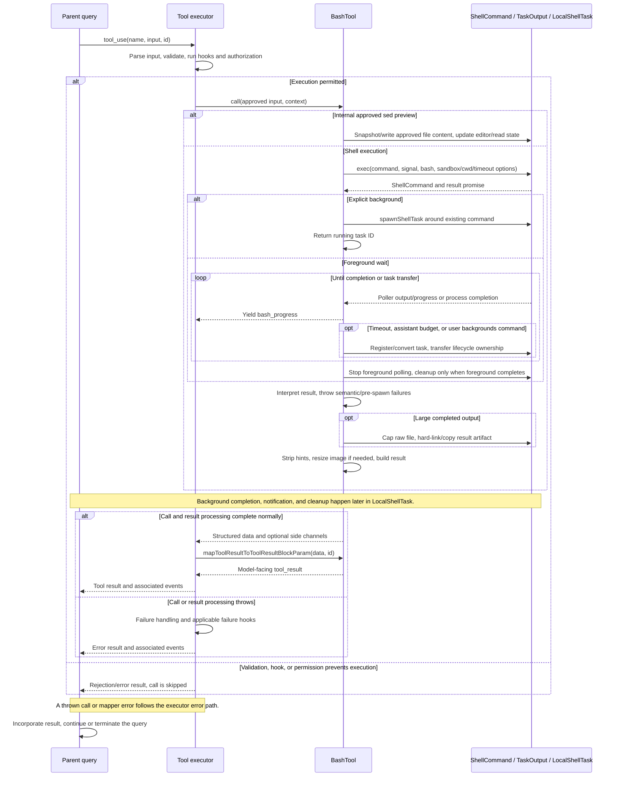
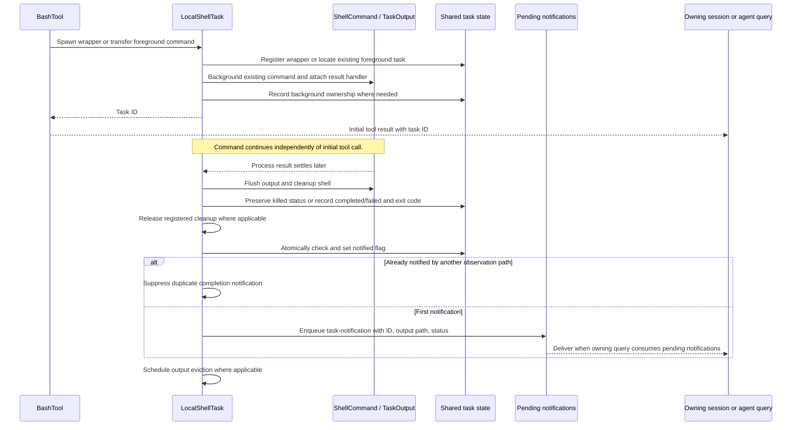

# BashTool Internals

Source: [tools/BashTool/BashTool.tsx](../../../../../tools/BashTool/BashTool.tsx). Line ranges refer to this recovered source snapshot; symbols are the stable navigation handles.

## Purpose and caller boundary

Executes a Bash command or applies an internal approved sed preview, streams progress, and returns either completion data or a background-task handle. Model input is strict command plus optional timeout/description/background/sandbox override. The internal _simulatedSedEdit field is excluded from the model schema. Concurrency safety depends on read-only command analysis; UI search/read classification is a separate heuristic.

The [shared invocation lifecycle](../../invocation-lifecycle.md) explains registry selection, schema validation, authorization, hooks, result mapping, and exception handling. The sequence below begins with a model tool request and ends at the parent conversation boundary; external services and background workers retain their own lifecycles.

## Source-order walkthrough

### 1. Imports and UI classification (1–171)

Dependencies cover shell/security parsing, permissions, task ownership, output storage, sed/history, sandboxing, image handling, hints, and telemetry. isSearchOrReadBashCommand splits operators, skips redirect targets/operators and neutral commands, and requires every remaining command to belong to search/read/list sets. Parse failure/neutral-only returns all false. This controls collapse labels, not permission.

### 2. Silent-command heuristic (173–220)

isSilentBashCommand requires at least one nonfallback command and all such commands in a silent set. Neutral fallback after || is ignored, while other unsupported commands make it false. The result selects Done versus No output UI, not command success semantics.

### 3. Background gate, schemas, and logging classifier (222–296)

Read CLAUDE_CODE_DISABLE_BACKGROUND_TASKS at module load because it changes schema exposure. fullInputSchema includes internal sed preview; public schema always omits it and conditionally omits run_in_background. Timeout is a semantic number without a max refinement here. getCommandTypeForLogging recognizes common background executables. Output includes streams, interruption, background cause, images/structured content, semantic result text, and persisted-output metadata.

### 4. Delay helpers (298–344)

isAutobackgroundingAllowed compares the first split subcommand with the disallowed sleep entry. detectBlockedSleepPattern separately recognizes leading integer sleep >=2 seconds, including a following command, while fractional/sub-two-second pacing is not blocked. Do not equate this shallow helper with a complete shell parse.

### 5. Approved sed write helper (346–410)

applySedEdit expands target, detects encoding, reads original content, and returns normal stderr text if that read reports ENOENT. It optionally snapshots history, preserves detected line endings, writes approved newContent directly, notifies VSCode, and updates full read state. It does not run sed or repeat FileEdit’s stale-content validation. The preview field’s trust comes from permission UI injection.

### 6. Metadata, read-only scheduling, hook matcher (412–489)

isReadOnly combines commandHasAnyCd and checkReadOnlyConstraints; isConcurrencySafe delegates to it. preparePermissionMatcher uses parseForSecurity: unavailable/complex parsing matches all rules to avoid skipping a hook. Simple commands strip leading assignments via argv and match any subcommand by prefix or wildcard. UI names sed edits like file edits and conditionally shows sandbox indicator; summary prefers supplied description.

### 7. Validation and authorization (491–554)

With MONITOR_TOOL and background enabled, a nonbackground blocked sleep gets validation code 10. Other input passes this validator. bashToolHasPermission owns detailed command/path/sandbox permission logic. UI/search extraction displays stdout/stderr only; model wrappers and background path text are separate.

### 8. Model mapper (555–622)

Structured content wins, then valid image data. Otherwise trim leading blank lines/end whitespace, wrap persisted-output preview if a path exists, append stderr and interrupted error text, and add explicit/manual/assistant-budget background guidance. Text is_error equals interrupted; ordinary nonzero command failures normally threw earlier. The early structured/image branches do not run that final interrupted flag assignment.

### 9. Call entry and generator consumption (624–690)

Internal sed preview returns immediately through applySedEdit. Otherwise allocate a bounded stdout accumulator and determine main versus agent context; agents prevent cwd changes. Consume runShellCommand manually with next(), forwarding yielded progress with synthetic IDs and capturing the generator RETURN ExecResult. Background task registration uses setAppStateForTasks when available.

### 10. Semantic exit handling (692–735)

Track git operations, identify user interrupt only when result.interrupted and signal.reason is interrupt, append merged stdout/stderr, and interpret exit status. Log index.lock diagnostics. Root calls reset cwd if outside permitted project context. Annotate sandbox failures; preSpawnError throws directly, and semantic errors throw ShellError unless it was a user interrupt. finally clears tool JSX even when this region throws.

### 11. Large-output preservation (737–763)

After successful/interrupt return, if output path/task ID exist, stat and remember ORIGINAL size, ensure result directory, truncate the SOURCE file to 64 MiB when necessary, then hard-link it or copy as fallback. Any failure is swallowed so inline preview remains usable. Source truncation precedes linking, despite comments describing copying first.

### 12. Hints, images, data (765–823)

Log command/indexing metrics, strip empty lines, extract/strip Claude hint tags unconditionally, and record recommendations only for root. Detect/resize image output; failed parse/resize classification falls back to text. Return output, reset-cwd stderr, semantic note, silent-command hint, background cause, sandbox override, and persistence metadata. Terminal truncation checks stdout/stderr.

### 13. Generator contract and exec (825–909)

runShellCommand yields progress and returns ExecResult. Choose timeout with timeout || default (no local maximum clamp), initialize latest output counters and a wakeable progress promise, derive auto-background eligibility, and await exec(command, signal, bash, options). onProgress snapshots output/counts and wakes the generator; exec chooses provider, sandbox, cwd handling, and ShellCommand ownership.

### 14. Task transfer helpers (911–967)

spawnBackgroundTask wraps the existing ShellCommand using its TaskOutput ID and shared state setter. startBackgrounding converts an already registered foreground task in place, avoiding duplicate registration/cleanup events; otherwise asynchronously spawns a wrapper, stores its ID, wakes the progress race, and invokes optional timeout continuation. It does not spawn the command a second time.

### 15. Timeout/assistant/explicit background (969–1009)

Register an onTimeout callback only when eligible. The KAIROS root 15-second unref timer is a separate condition and does not consult the sleep eligibility helper. Explicit background is honored for any command type when enabled and returns synthetic code-zero, noninterrupted output with task ID. That result means work continues.

### 16. Initial wait and progress lifecycle (1011–1050)

Race process completion against a two-second unref timer. Fast completion cleans ShellCommand and returns immediately. Already backgrounded returns its handle. Otherwise start TaskOutput polling; each loop races process result against the poller-driven wake signal.

### 17. Completion/background race (1052–1095)

If a completed result still has backgroundTaskId, mark the task notified, strip that ID, restore large-output file metadata when applicable, clean the shell, and return a completed result. Normal foreground completion unregisters its foreground entry then cleans. This avoids returning a running label and redundant completion notice after the process already exited.

### 18. Running background/progress return (1097–1143)

If backgroundShellId is set, return handle; if foreground task status became backgrounded via Ctrl+B, return manual-background metadata. Otherwise register foreground task once when eligible/UI available, show BackgroundHint, and yield output/timing/counts. finally stops polling. Background ShellCommand cleanup belongs to LocalShellTask; this generator’s finally itself only stops polling.

## End-to-end sequence

The success arrows after `call` describe normal completion. An exception skips normal result mapping; see the failure boundaries below. Query continuation remains subject to cancellation and turn/budget limits.

## Background completion sequence

The initial tool result can precede process completion. [`LocalShellTask.tsx`](../../../../../tasks/LocalShellTask/LocalShellTask.tsx) owns the later result handler, output flush, status update, and notification deduplication. Notification delivery remains subject to the owning session or agent consuming its queue.

## State, failure, and cancellation boundaries

ShellCommand receives the abort signal: ordinary abort kills, while reason interrupt is intentionally ignored by its low-level handler so a caller can transfer ownership. This Bash generator contains no explicit interrupt-to-background branch; avoid assuming parity with PowerShell. Timeout can background or terminate depending on eligibility/callback. background() removes foreground listeners/timeouts and keeps a size watchdog or disk spill path. LocalShellTask later flushes/cleans, updates terminal status, and queues notification. A returned task ID is not command completion. Persisted size can exceed retained bytes after the 64-MiB cap, and hard linking shares the capped inode.

## Related design

[Permission pipeline](./permissions.md), [path validation](./path-validation.md), [security parsing](./security.md), [read-only analysis](./read-only-validation.md), and [sed validation](./sed-validation.md) expand the delegated guards.
