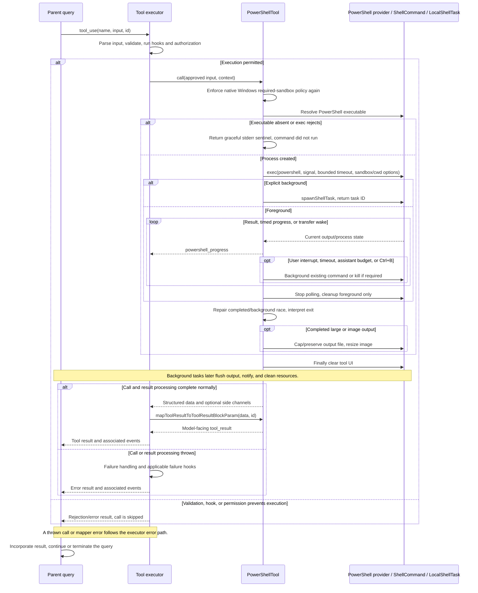
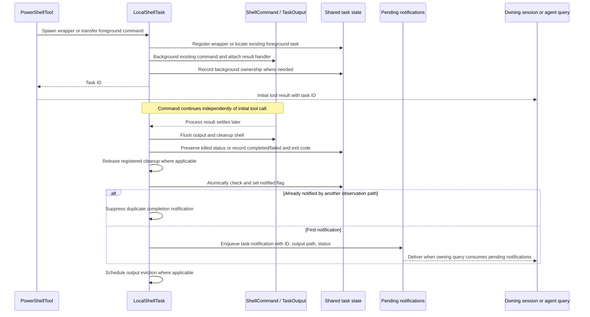

# PowerShellTool Internals

Source: [tools/PowerShellTool/PowerShellTool.tsx](../../../../../tools/PowerShellTool/PowerShellTool.tsx). Line ranges refer to this recovered source snapshot; symbols are the stable navigation handles.

## Purpose and caller boundary

Executes PowerShell through the shared Shell/ShellCommand/LocalShellTask runtime with PowerShell-specific permission and exit semantics. Strict input includes command and optional timeout/description/background/sandbox override. Output carries streams, interruption, images, persistence, and background identity/cause. Registry availability is gated externally; the constructed tool’s isEnabled returns true.

The [shared invocation lifecycle](../../invocation-lifecycle.md) explains registry selection, schema validation, authorization, hooks, result mapping, and exception handling. The sequence below begins with a model tool request and ends at the parent conversation boundary; external services and background workers retain their own lifecycles.

## Source-order walkthrough

### 1. Dependencies and UI classification (1–157)

Canonical cmdlet sets classify search/read behavior. The synchronous heuristic splits on semicolon/pipe, canonicalizes aliases, ignores output-neutral commands, and requires all other parts to be known search/read commands. It is intentionally shallow and separate from AST permission decisions. Terminal output uses LF even on Windows.

### 2. Timing, sleep, and platform guard (159–218)

Progress begins after two seconds and repeats each second; assistant budget is 15 seconds. Automatic timeout backgrounding excludes canonical Start-Sleep/sleep first words. detectBlockedSleepPattern recognizes leading integer seconds >=2, including -Seconds/-s, but permits milliseconds/fractions. isWindowsSandboxPolicyViolation checks native Windows plus enabled required sandbox and forbidden unsandboxed commands.

### 3. Schemas and logging (220–271)

The module-load background-disabled flag removes run_in_background from model schema. Unlike Bash there is no simulated-sed field. Timeout’s described maximum is not a schema refinement, but the generator later clamps it. Logging matches the first word against a fixed executable/cmdlet set case-insensitively.

### 4. Registration and conservative scheduling (273–350)

isConcurrencySafe delegates to isReadOnly. Synchronous security concerns force false; the AST-free isReadOnlyCommand only recognizes the simplest cases. Full async permission checking can allow more commands without changing this conservative scheduling decision. Classifier is raw command and UI summary prefers description.

### 5. Validation and permission delegation (352–381)

Reject native Windows sandbox-policy violation with code 11, then gated blocking-sleep pattern with code 10. powershellToolHasPermission owns async parsing/rules/path checks. The policy guard is repeated in call because direct prompt-shell/user-command callers can bypass validateInput.

### 6. Model mapper (383–448)

Try image mapping first. Otherwise trim output and optionally replace it with a persisted-file preview wrapper. Append stderr, interruption marker, and background cause/path guidance. Text is_error reflects interrupted. Error exit statuses are normally handled by call throwing ShellError; a graceful preflight stderr result can therefore remain non-error.

### 7. Call guard and generator consumption (450–494)

Repeat required-sandbox policy guard and throw on violation. Determine root/agent cwd behavior, runPowerShellCommand with shared task setter, and manually consume progress yields until the returned ExecResult. Progress IDs are synthetic ps-progress counters.

### 8. Sentinel tracking, cwd, background shortcut (496–545)

Skip git-success tracking for the code-zero/empty-stdout/nonempty-stderr/nonbackground preflight sentinel. Recognize user interrupt by exact signal reason. Root cwd reset runs before background early return. Background output strips hint tags, records root recommendations, and returns running metadata with interrupted false, without foreground output persistence/image handling.

### 9. Foreground interpretation and errors (547–585)

Accumulate/trim stdout, interpret PowerShell/native executable exit semantics, strip hints, and record root hints. preSpawnError throws before semantic interpretation can misclassify it as a no-match exit. Semantic error throws ShellError unless it is a user-driven interrupt. Distinct stderr is preserved.

### 10. Persistence/images/result/finally (587–666)

Only after error checks, preserve large output by stat/ensure directory, source truncation to 64 MiB, hard-link or copy, swallowing persistence failure. Resize recognized image data or fall back to text. Merge process stderr and cwd-reset note, log metrics, and return data. finally always clears tool JSX, including failures during postprocessing.

### 11. Generator setup and preflight (668–762)

Clamp timeout to min(timeout || default, max), initialize progress/background state, and resolve cached PowerShell executable. Missing executable returns the graceful code-zero stderr sentinel. exec uses the tool signal and powershell provider; native Windows explicitly disables sandbox after the policy guard, while supported platforms use shouldUseSandbox. An exec rejection is logged and converted to the same sentinel shape.

### 12. Task transfer and timers (764–858)

spawnShellTask wraps the running ShellCommand. startBackgrounding converts an existing foreground entry in place or asynchronously registers one and wakes the race. Timeout callback respects automatic eligibility. The separate KAIROS root 15-second timer does not consult that eligibility helper. Explicit background returns immediately with task ID when enabled.

### 13. Polling and completion race (860–921)

Start TaskOutput polling immediately, then race result, next timed progress tick, and transfer wake signal. Completion carrying backgroundTaskId is repaired by marking notified, stripping ID, recovering output-file metadata, and cleaning the completed command. Other completion returns actual result and lets finally perform foreground cleanup.

### 14. Interrupt and manual background (923–959)

A stored background ID returns running metadata, preserving fullOutput when interruptBackgroundingStarted. On first aborted signal with reason interrupt, set that flag and background when allowed, then continue so it is not mislabelled as Ctrl+B. If background disabled, call kill. A foreground status backgrounded by UI separately returns backgroundedByUser true.

### 15. Progress and cleanup ownership (961–1000)

After threshold, register foreground entry once and display BackgroundHint. Yield latest output/counts/time/task ID and schedule next one-second progress deadline. finally always stops polling, then unregisters/cleans only when no background ID and shell status is not backgrounded. Running background tasks remain owned by LocalShellTask.

## End-to-end sequence

The success arrows after `call` describe normal completion. An exception skips normal result mapping; see the failure boundaries below. Query continuation remains subject to cancellation and turn/budget limits.

## Background completion sequence

The initial tool result can precede process completion. [`LocalShellTask.tsx`](../../../../../tasks/LocalShellTask/LocalShellTask.tsx) owns the later result handler, output flush, status update, and notification deduplication. Notification delivery remains subject to the owning session or agent consuming its queue.

## State, failure, and cancellation boundaries

The Windows policy check covers direct call sites even without executor validation. readOnly scheduling is stricter than async permission analysis. Low-level ShellCommand ignores user-interrupt aborts; this generator explicitly backgrounds or kills them. Graceful executable/spawn failures are normal stderr results with code zero sentinel, whereas inner preSpawnError and semantic failures throw. Background transfer removes foreground cancellation/timeout ownership, so later TaskStop/session cleanup uses the task lifecycle. Source truncation precedes hard-link/copy, and the recorded size is pre-cap.

## Related design

[Bash internals](../BashTool/internals.md) explains shared runtime ownership; [PowerShell overview](./README.md) maps parser, permission, and shell-provider dependencies.
