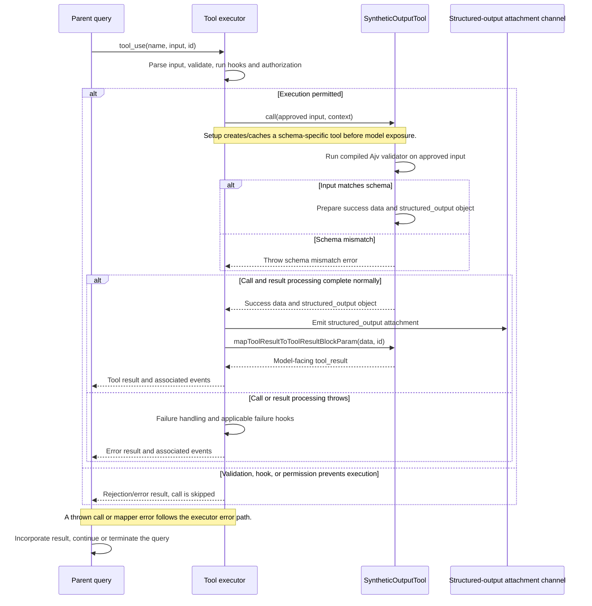

# SyntheticOutputTool Internals

Source: [tools/SyntheticOutputTool/SyntheticOutputTool.ts](../../../../../tools/SyntheticOutputTool/SyntheticOutputTool.ts). Line ranges refer to this recovered source snapshot; symbols are the stable navigation handles.

## Purpose and caller boundary

Provides a StructuredOutput tool configured by a caller-supplied JSON schema. Its ordinary model-facing result is a success string; actual output travels separately in the call result’s structured_output field. The helper enables creation for noninteractive sessions, while an already-created tool reports enabled.

The [shared invocation lifecycle](../../invocation-lifecycle.md) explains registry selection, schema validation, authorization, hooks, result mapping, and exception handling. The sequence below begins with a model tool request and ends at the parent conversation boundary; external services and background workers retain their own lifecycles.

## Source-order walkthrough

### 1. Base contract and availability (1–27)

The Zod input accepts any object with passthrough. Output schema is a string. isSyntheticOutputToolEnabled reads isNonInteractiveSession; it is not the configured JSON validator.

### 2. Base tool metadata and call (28–65)

The base is read-only, concurrency-safe, and not open-world. The prompt requests exactly one final call, but this module does not enforce count or end-of-turn position. Its base call echoes structured_output and a success data string without Ajv validation.

### 3. Permission, UI, and mapper (66–103)

Tool-specific permissions return allow with input unchanged. UI renders no fields, up to three key/value pairs, or a field-count preview. Rejection/error are fixed labels. The mapper emits only data, so the structured output is a separate executor/caller channel.

### 4. Factory identity cache (105–129)

A WeakMap keyed by the exact schema object caches both successful tools and error results. Same-reference reuse avoids Ajv compilation. Structurally equal new objects compile independently; mutating a schema object does not invalidate its cached compiled tool.

### 5. Schema compilation (131–142)

Create Ajv with allErrors, validate the JSON schema, and return diagnostic error if invalid. Compile once. The configured object spreads the base tool and supplies inputJSONSchema plus an overridden call.

### 6. Per-call validation and failures (143–164)

The configured call runs the compiled validator, joins instancePath/message errors, and throws a telemetry-safe mismatch error on failure. Success preserves the original object as structured_output. Factory compilation exceptions are converted to {error}; call-time mismatches throw to the executor.

## End-to-end sequence

The success arrows after `call` describe normal completion. An exception skips normal result mapping; see the failure boundaries below. Query continuation remains subject to cancellation and turn/budget limits.

## State, failure, and cancellation boundaries

No filesystem/network work or explicit cancellation occurs in the call. The factory’s {error} is a setup outcome, distinct from a tool_result. Using the unconfigured base tool bypasses Ajv checks. The structured-output side channel must be consumed by the surrounding query/headless lifecycle; the success text alone does not contain the JSON.
