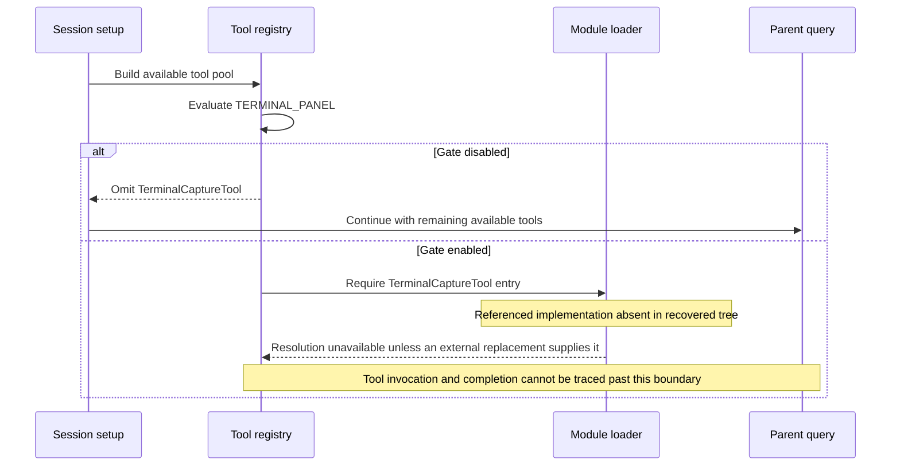

# TerminalCaptureTool Recovered Design Boundary

Evidence: [`tools.ts`](../../../../../tools.ts), registry load region 114–117. Referenced entry: `tools/TerminalCaptureTool/TerminalCaptureTool.js`; no corresponding recovered `.ts`, `.tsx`, or `.js` entry exists in this checkout.

## Scope and contract

**Coverage: boundary only; implementation absent.** A fine-grained execution walkthrough cannot be supplied for code that is not present. This document records the verified registration path and explicitly ends the sequence at that boundary.

The conditional reference does not reveal capture scope, terminal identity, image/text representation, or permission checks.

Input/output schemas, tool-specific permission decisions, execution state, cancellation propagation, and cleanup cannot be confirmed from the registry reference alone. The [shared invocation lifecycle](../../invocation-lifecycle.md) applies only after an actual tool object is available.

## Source-order boundary

1. During registry module evaluation, test `TERMINAL_PANEL`.
2. With the condition false, retain null and omit this conditional tool from the base list.
3. With the condition true, the source attempts to load the referenced entry.
4. A normally resolved tool would enter the base pool, followed by availability/policy filtering and eventual model invocation. In this recovered tree that resolution boundary lacks its implementation; no successful call is asserted.

## End-to-end sequence: verified boundary

This is a registry-to-invocation-boundary diagram, not a fabricated successful execution. Runtime shims or a different distribution could supply behavior, but that behavior must be inspected separately before documenting its end-to-end workflow.
