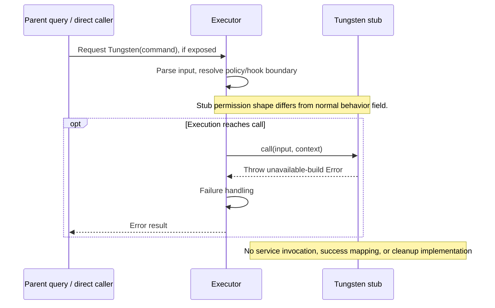

# TungstenTool Internals

Source: [tools/TungstenTool/TungstenTool.ts](../../../../../tools/TungstenTool/TungstenTool.ts). Line ranges refer to this recovered source snapshot; symbols are the stable navigation handles.

## Purpose and caller boundary

This recovered file is an explicit unavailable-tool stub, not an implementation of the internal execution service. It accepts a strict command string but cannot execute it. Internal-user registry inclusion does not make the stub runnable.

The [shared invocation lifecycle](../../invocation-lifecycle.md) explains registry selection, schema validation, authorization, hooks, result mapping, and exception handling. The sequence below begins with a model tool request and ends at the parent conversation boundary; external services and background workers retain their own lifecycles.

## Source-order walkthrough

### 1. Schema and metadata (1–32)

Output is typed as {output: string}; no output schema is declared. The tool name is Tungsten, and description/prompt report unavailability. Scheduling and read-only flags are false.

### 2. Permission shape and UI (33–47)

The stub returns `{result: allow, message: empty}` rather than the normal PermissionResult behavior field. This mismatch must not be interpreted as a verified permission bypass. Renderers return null.

### 3. Execution and mapper (48–59)

call unconditionally throws an unavailable-build Error. The fixed mapper would return unavailable text if invoked manually, but normal successful execution never reaches it.

### 4. Exported cleanup stubs (61–68)

clearSessionsWithTungstenUsage and resetInitializationState have empty bodies. They perform neither session cleanup nor initialization.

## End-to-end sequence

The success arrows after `call` describe normal completion. An exception skips normal result mapping; see the failure boundaries below. Query continuation remains subject to cancellation and turn/budget limits.

## State, failure, and cancellation boundaries

Normal success mapping is unreachable for this implementation; the executor emits its error result. The internal service’s real schema, transport, cancellation, state, and cleanup cannot be reconstructed from these stubs. Documentation deliberately stops at the recovered boundary.
