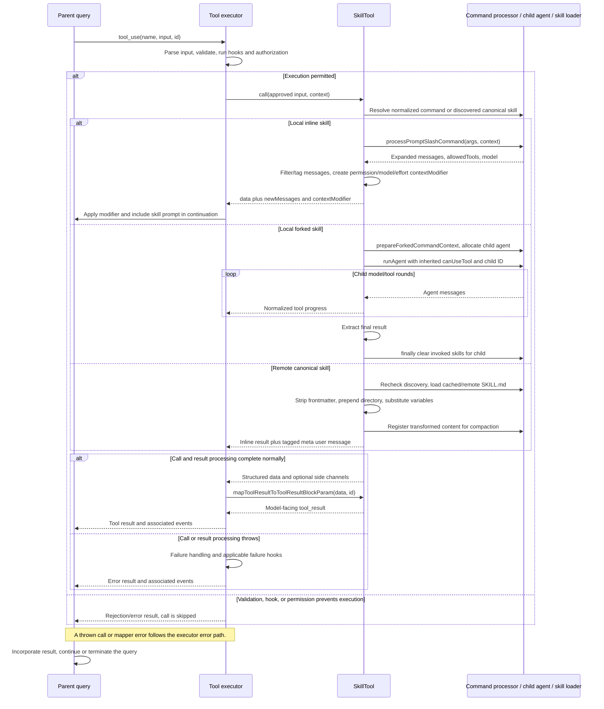

# SkillTool Internals

Source: [tools/SkillTool/SkillTool.ts](../../../../../tools/SkillTool/SkillTool.ts). Line ranges refer to this recovered source snapshot; symbols are the stable navigation handles.

## Purpose and caller boundary

Invokes a prompt-based command through one of three paths: inline expansion into the parent conversation, synchronous forked-agent execution, or gated remote canonical Markdown injection. Input is a non-strict object with skill and optional args. Inline success means prompt installation; forked success includes a completed child result. The tool retains serial scheduling because inline expansion changes subsequent query context.

The [shared invocation lifecycle](../../invocation-lifecycle.md) explains registry selection, schema validation, authorization, hooks, result mapping, and exception handling. The sequence below begins with a model tool request and ends at the parent conversation boundary; external services and background workers retain their own lifecycles.

## Source-order walkthrough

### 1. Command discovery and gated dependencies (1–116)

getAllCommands combines project-root local/bundled commands with AppState MCP commands whose type is prompt and loadedFrom is mcp. Plain MCP prompts are excluded. Local entries win name deduplication. EXPERIMENTAL_SKILL_SEARCH conditionally loads remote discovery/loader/telemetry helpers to preserve build-time elimination.

### 2. Fork setup and telemetry (118–221)

executeForkedSkill allocates an agent ID, classifies built-in/bundled/official/custom identity, and records invocation depth/plugin/discovery metadata. Await prepareForkedCommandContext to obtain prompt messages, modified state getter, base agent, and skill content. Merge command effort into the agent definition. This preparation occurs before the execution try/finally.

### 3. Fork execution and cleanup (223–289)

Run runAgent synchronously with modified context, inherited canUseTool, available tools, optional model override, and explicit child ID. Collect all messages; normalize assistant/user messages and forward only tool-use/result-bearing messages as skill_progress. Extract result text, clear collected messages, and return status forked. finally clears invoked-skill state for that agent even on execution failure. It does not roll back child tool effects.

### 4. Public schemas and metadata (291–351)

Output union separates optional inline status/allowedTools/model from required forked status/agentId/result. Classifier records skill name. Prompt generation is project-root-aware. Read-only/concurrency overrides are absent, preserving conservative defaults.

### 5. Validation (353–436)

Trim skill; reject blank (code 1), remove one leading slash with telemetry. Internal experimental canonical names must be discovered in session (6), then skip local lookup. Otherwise load commands, reject missing (2), disableModelInvocation (4), or nonprompt command (5). args are separate; the tool does not parse embedded command-line arguments out of skill.

### 6. Rule matching and permission precedence (438–530)

Normalize leading slash on both command and rules. Match exact name or startsWith prefix for rules ending :*. Iterate deny rules first, then auto-allow discovered canonical path under internal experimental gating, then explicit allows, then the safe-property allowlist. This checker does not implement a separate ask-rule loop; the shared permission layer remains relevant.

### 7. Permission fallback (532–579)

Return ask with exact-name and prefix allow-rule suggestions for localSettings, original skill/args as updatedInput, and command metadata when known. A skill’s safe-property decision affects this wrapper invocation; downstream tools still use their own authorization and the expanded command context.

### 8. Call routing (581–631)

Normalize skill again. Canonical remote names route to executeRemoteSkill before local usage tracking. Otherwise resolve commands, record usage, and if prompt context is fork delegate to executeForkedSkill. Ordinary paths dynamically import processPromptSlashCommand and expand args (default empty). A false shouldQuery throws.

### 9. Inline metadata/telemetry (633–731)

Capture allowedTools/model from processed command and effort from original prompt command. Record built-in/bundled/official/custom identity, depth, plugin and discovery data. Telemetry is grouped with the expansion it describes, not a separate execution branch.

### 10. Inline message filtering and return (733–777)

Find the parent Skill tool-use ID. Filter progress events and user string messages containing command-message display markup; tag remaining user/attachment/system messages with sourceToolUseID. processPromptSlashCommand already registered invoked content/hooks, so do not duplicate registration. Return success metadata plus newMessages and a contextModifier.

### 11. Context modifier (779–839)

Chain the prior getAppState rather than closing over the original context. Merge allowedTools into command-scoped alwaysAllowRules using a Set. Apply model override via resolveSkillModelOverride to preserve a compatible [1m] suffix. If effort is specified, wrap the newly modified getter again to override effortValue. These are returned context views/options, not direct writes to persistent permission files.

### 12. Mapper and UI (841–870)

Forked output reports completion and result text; inline output says Launching skill. The actual inline prompt is in newMessages, not that confirmation. Imported UI handles progress/rejection/errors.

### 13. Safe-property and identity helpers (872–965)

The explicit key allowlist treats known command metadata as safe. Unknown keys with undefined/null, empty arrays, or empty objects are ignored; any other value requires permission, including false/zero. Official marketplace classification requires plugin source and repository metadata. URL-scheme telemetry recognizes gs/http/https/s3 and defaults unknown to gs; it does not authorize transport.

### 14. Remote metadata/load (967–1020)

Re-read discovery metadata and throw if lost since validation. Await loadRemoteSkill(slug,url); load errors are logged as remote-load telemetry and wrapped. Successful load supplies cache/path/content/count/byte/fetch metadata and invocation telemetry. This call does not pass the tool abort signal into the loader.

### 15. Remote content transformation (1022–1089)

Record usage, strip YAML frontmatter, prepend cached skill base directory, normalize Windows separators, and substitute CLAUDE_SKILL_DIR and CLAUDE_SESSION_ID. No local !command or $ARGUMENTS expansion runs on this path. Register FINAL transformed content with addInvokedSkill for compaction preservation under ambient agent identity.

### 16. Remote injection (1091–1109)

Return inline success and one meta user message containing transformed Markdown, tagged with parent tool-use identity. No forked agent is launched and no allowed-tools/model/effort modifier is returned for remote Markdown by this function.

## End-to-end sequence

The success arrows after `call` describe normal completion. An exception skips normal result mapping; see the failure boundaries below. Query continuation remains subject to cancellation and turn/budget limits.

## State, failure, and cancellation boundaries

Inline launch does not mean the skill’s requested work finished; the parent model processes newMessages later. Forked execution waits for runAgent, which owns child cancellation and tool effects. Invoked-skill cleanup is finally-protected only after fork preparation succeeds. Command discovery/processing/load can fail between validation and execution. Remote injection deliberately skips local command substitutions. Returning allowedTools in a modifier changes subsequent context policy but does not retroactively authorize a failed wrapper call.

## Related design

[Agent runner](../../delegation-teams-agent-runtime/agenttool/agent-runner.md) and [command system](../../../commands.md) expand the child and slash-command dependencies.
