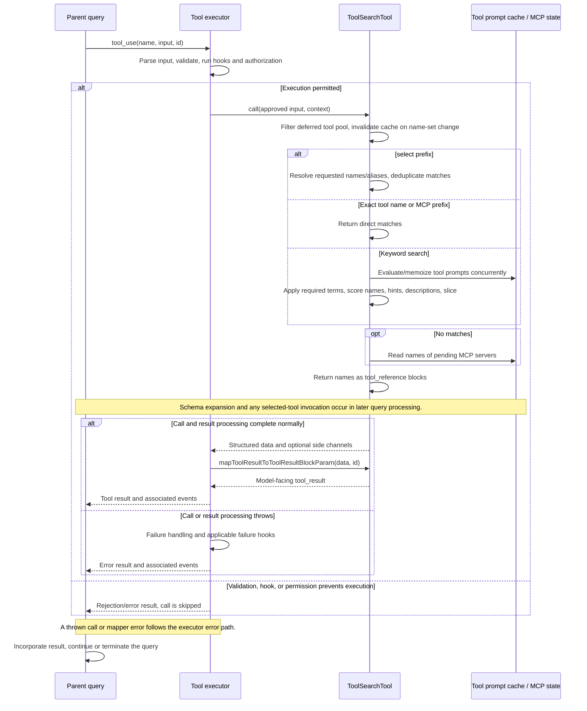

# ToolSearchTool Internals

Source: [tools/ToolSearchTool/ToolSearchTool.ts](../../../../../tools/ToolSearchTool/ToolSearchTool.ts). Line ranges refer to this recovered source snapshot; symbols are the stable navigation handles.

## Purpose and caller boundary

Finds tools in the supplied tool pool and returns tool_reference blocks for subsequent model use. It does not execute the selected tools or grant permission. Input is a non-strict object with query and numeric max_results default five; there is no positive/integer refinement. The optimistic enablement gate controls this read-only/concurrency-safe discovery tool.

The [shared invocation lifecycle](../../invocation-lifecycle.md) explains registry selection, schema validation, authorization, hooks, result mapping, and exception handling. The sequence below begins with a model tool request and ends at the parent conversation boundary; external services and background workers retain their own lifecycles.

## Source-order walkthrough

### 1. Schemas and description cache (1–104)

Output carries match names, original query, total deferred count, and optional pending-server names. Cache key is sorted deferred tool names, while descriptions are memoized by tool name only. A name-set change clears descriptions. Prompt evaluation uses a synthetic default permission context and empty agents. Same names with changed descriptions need explicit clearToolSearchDescriptionCache or another invalidation trigger.

### 2. Result/name/regex helpers (106–177)

buildSearchResult omits empty pending metadata. MCP names split server/action and underscores after dropping mcp__; ordinary names split CamelCase/underscores. Compile escaped word-boundary regexes once per unique term; terms are literal keywords, not arbitrary regular expressions.

### 3. Keyword shortcuts (179–218)

Trim/lower query. Exact name match checks deferred then full pool and returns a single canonical name, even if already loaded. An mcp__ prefix query returns matching deferred prefixes up to maxResults before general scoring.

### 4. Required terms (220–257)

Split whitespace; +term means required, other terms optional. Fetch descriptions concurrently and require every required term to match a name part/substring, description word, or hint word. Only survivors enter scoring. Description fetch rejection is not isolated per tool.

### 5. Weighted scoring (259–309)

For every term add 12/10 for exact MCP/ordinary name part, else 6/5 for part substring. Full-name substring adds three only when the cumulative score is still zero. Hint word adds four and description word two. Keep positive scores, sort descending, slice maxResults, and return names. Equal scores preserve input-relative sort behavior; no semantic embedding search occurs.

### 6. Registration and call setup (311–363)

Expose prompt/schema and optimistic gate. Filter supplied options.tools with isDeferredTool and invalidate cache. Pending-server helper reads current AppState only when needed. Telemetry records query type, counts, and requested max.

### 7. Direct select (365–419)

Case-insensitive select: prefix recognizes a nonempty remainder without trimming the entire query first. Split commas, trim names, and resolve via findToolByName against deferred then full pool. Deduplicate canonical found names. Missing-only returns empty plus pending-server metadata; partial success logs missing names but returns only found ones. This branch does not apply max_results.

### 8. Keyword return (421–442)

Await keyword search, log outcome, and attach pending-server names only for zero matches. No wait/reconnect is performed for pending MCP servers. total_deferred_tools is the candidate-pool count, not the total number of matches.

### 9. UI and mapper (444–472)

Use renderer is null and user-facing name empty. Empty results become ordinary text plus pending-server guidance. Matches become one tool_reference block per name. Provider expansion support is a downstream concern; this mapper does not materialize schemas itself.

## End-to-end sequence

The success arrows after `call` describe normal completion. An exception skips normal result mapping; see the failure boundaries below. Query continuation remains subject to cancellation and turn/budget limits.

## State, failure, and cancellation boundaries

Discovery is not authorization or execution. max_results affects prefix/scored searches but not direct selection or exact-name shortcut. Description-cache identity can retain changed prompt content under stable names. Prompt-fetch errors propagate; pending servers merely add guidance. There is no abort-aware search wait in this module. A selected already-loaded tool is a harmless discovery no-op, but its eventual call still crosses the normal permission boundary.
