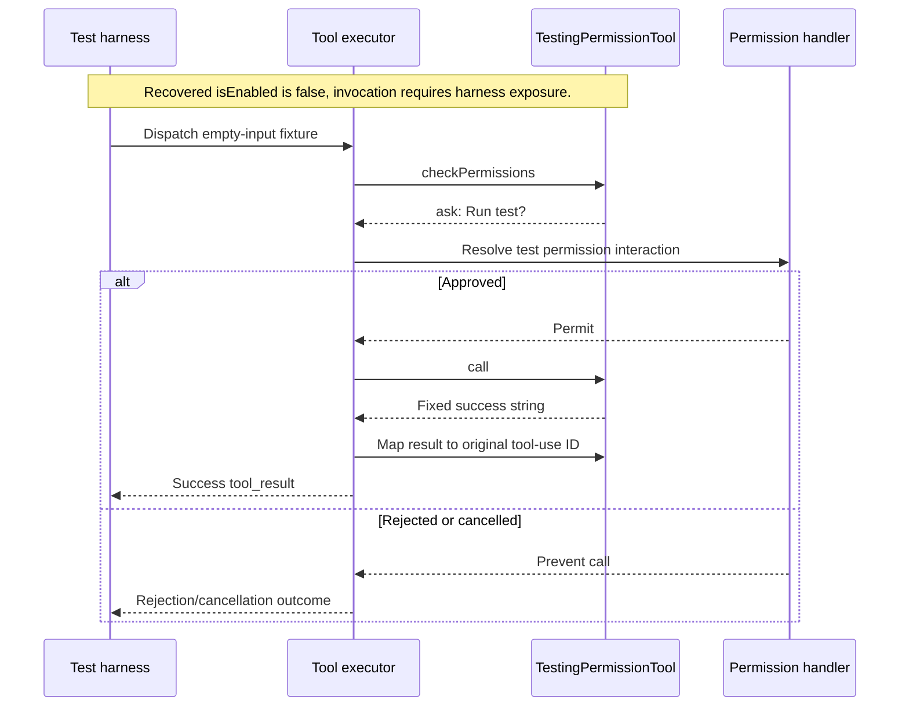

# TestingPermissionTool Internals

Source: [tools/testing/TestingPermissionTool.tsx](../../../../../tools/testing/TestingPermissionTool.tsx). Line ranges refer to this recovered source snapshot; symbols are the stable navigation handles.

## Purpose and caller boundary

A permission-dialog fixture with strict empty input and fixed string result. The registry conditionally adds it in test environments, but the recovered isEnabled body compares the literal production to test and therefore returns false. Its invocation sequence is conditional on a harness exposing it; it is not normally callable in this snapshot.

The [shared invocation lifecycle](../../invocation-lifecycle.md) explains registry selection, schema validation, authorization, hooks, result mapping, and exception handling. The sequence below begins with a model tool request and ends at the parent conversation boundary; external services and background workers retain their own lifecycles.

## Source-order walkthrough

### 1. Contract and registration (1–29)

The prompt identifies testing use. maxResultSizeChars is 100,000 and the tool is read-only/concurrency-safe. The literal enabled check is an archive detail, distinct from tools.ts’s environment gate.

### 2. Ask decision and empty renderers (30–60)

checkPermissions returns behavior ask with Run test? text. All use/progress/queue/rejection/result/error renderers return null, so the visible interaction is supplied by the permission system.

### 3. Call and mapping (61–73)

After permitted execution, return a fixed executed-successfully string. The mapper converts it to String and associates the original tool-use ID. There are no external effects.

## End-to-end sequence

The success arrows after `call` describe normal completion. An exception skips normal result mapping; see the failure boundaries below. Query continuation remains subject to cancellation and turn/budget limits.

## State, failure, and cancellation boundaries

This fixture tests the permission boundary, not a real operation. Denial/cancellation belongs to the permission handler. It has no internal awaitable work or cleanup. Its ask metadata does not prove a dialog always appears under every test policy/hook configuration.
