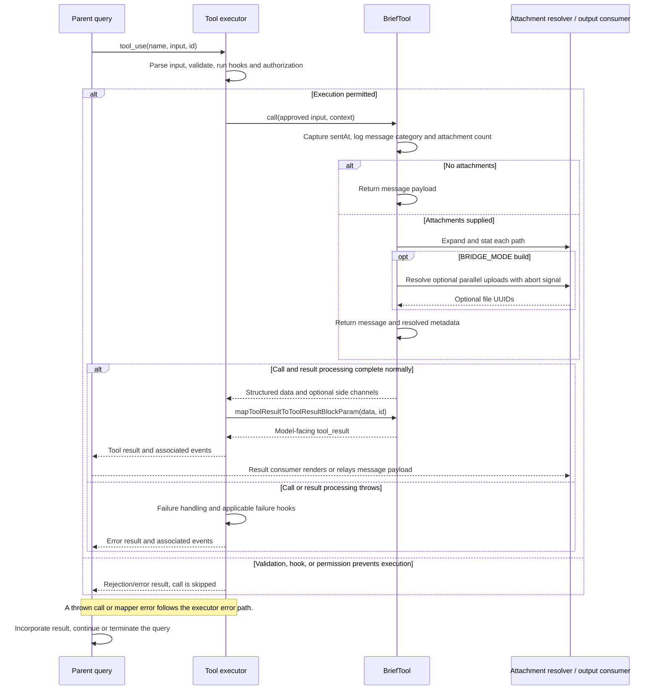

# BriefTool Internals

Source: [tools/BriefTool/BriefTool.ts](../../../../../tools/BriefTool/BriefTool.ts). Line ranges refer to this recovered source snapshot; symbols are the stable navigation handles.

## Purpose and caller boundary

Produces the user-visible message payload for brief/assistant mode, optionally resolving attachments. Strict input contains message, optional attachment paths, and required normal/proactive status. Output contains message, optional resolved attachments, and optional sentAt for backward-compatible transcript replay. Delivery/rendering is owned by consumers of the tool result.

The [shared invocation lifecycle](../../invocation-lifecycle.md) explains registry selection, schema validation, authorization, hooks, result mapping, and exception handling. The sequence below begins with a model tool request and ends at the parent conversation boundary; external services and background workers retain their own lifecycles.

## Source-order walkthrough

### 1. Contracts (1–64)

Attachment output retains absolute path, size, image flag, and optional uploaded file_uuid. sentAt is execution-time timestamp, not an acknowledgement from a user device. Status is not returned; it feeds telemetry.

### 2. Entitlement (66–101)

isBriefEntitled requires KAIROS or KAIROS_BRIEF build support, then permits active assistant mode, a truthy CLAUDE_CODE_BRIEF override, or a cached/refreshed runtime enrollment gate. The refresh interval is five minutes; entitlement alone is distinct from session opt-in.

### 3. Activation (103–137)

isBriefEnabled repeats the build guard and requires active assistant mode or userMsgOptIn, AND entitlement. The module reads initialized bootstrap state lazily. Opt-in can come from CLI/settings/commands elsewhere; this helper does not set it.

### 4. Registration and attachment validation (139–179)

The tool preserves its legacy alias, empty user-facing name, read-only/concurrent-safe flags, and message classifier. If no paths, validation succeeds. Otherwise validateAttachmentPaths checks each expanded path is a regular file; missing/inaccessible/nonfile yields code 1 and unexpected errors throw.

### 5. Mapper and call (180–205)

The mapper says delivered with attachment count. call timestamps and logs proactive/count metadata first; no attachments returns immediately. Otherwise snapshot replBridgeEnabled and call resolveAttachments with the abort signal, returning resolved metadata and original message.

### 6. Attachment dependency (attachments.ts)

Resolve paths and stat sequentially for deterministic ordering, deriving size and image status by extension. BRIDGE_MODE conditionally imports upload support, enables it for bridge state or CLAUDE_CODE_BRIEF_UPLOAD, and uploads concurrently. Undefined upload UUID preserves local metadata, so upload failure can retain a local attachment. Stat races/errors propagate instead of pretending attachment resolution succeeded.

## End-to-end sequence

The success arrows after `call` describe normal completion. An exception skips normal result mapping; see the failure boundaries below. Query continuation remains subject to cancellation and turn/budget limits.

## State, failure, and cancellation boundaries

The fixed delivered mapper text is not a remote delivery acknowledgement. This entry point does not send a message through an independent chat API; consumers render or relay its data. Attachment uploads can occur despite read-only metadata. Upload fallback and filesystem exceptions have different semantics, and cancellation applies to upload transport where forwarded, not to already delivered bytes.
