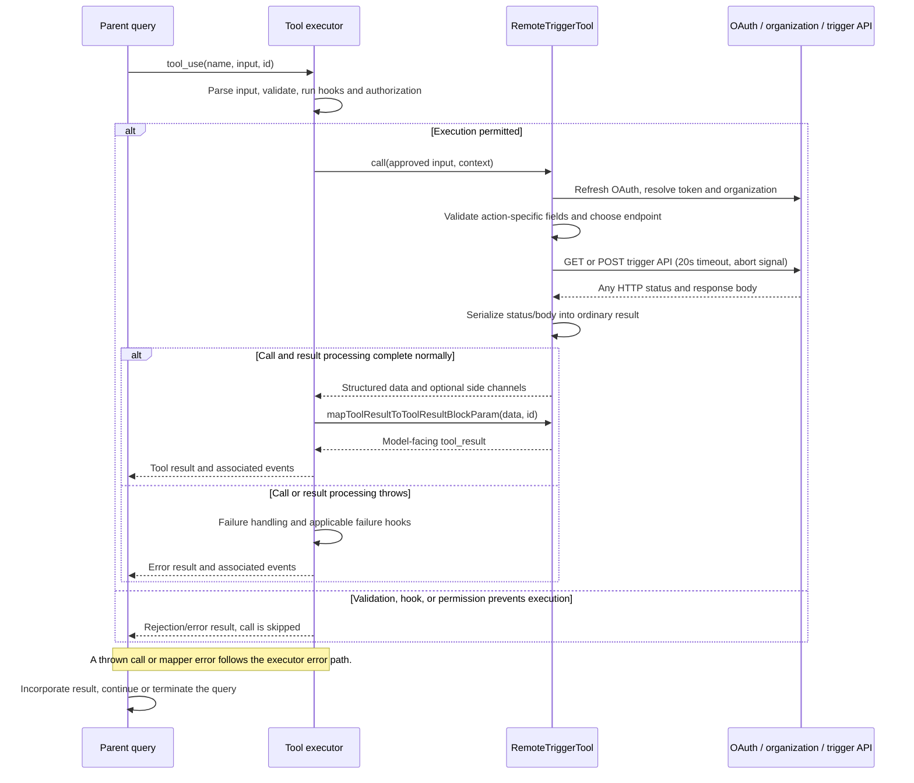

# RemoteTriggerTool Internals

Source: [tools/RemoteTriggerTool/RemoteTriggerTool.ts](../../../../../tools/RemoteTriggerTool/RemoteTriggerTool.ts). Line ranges refer to this recovered source snapshot; symbols are the stable navigation handles.

## Purpose and caller boundary

Proxies list/get/create/update/run operations to the organization-scoped remote trigger API. Strict input accepts action, optional regex-constrained trigger_id, and optional object body. Output preserves numeric HTTP status and JSON text. Deferred and concurrency-safe, it marks only list/get read-only; registry/runtime feature and remote-session policy gates control exposure.

The [shared invocation lifecycle](../../invocation-lifecycle.md) explains registry selection, schema validation, authorization, hooks, result mapping, and exception handling. The sequence below begins with a model tool request and ends at the parent conversation boundary; external services and background workers retain their own lifecycles.

## Source-order walkthrough

### 1. Schemas and gates (1–78)

trigger_id permits word characters and hyphens. Action-dependent requirements are not schema refinements. The feature gate is tengu_surreal_dali plus allow_remote_sessions policy. Classifier text includes action and optional ID. The fixed beta is ccr-triggers-2026-01-30.

### 2. Authentication and organization (79–100)

Refresh OAuth if needed, require an access token, and await organization UUID; either missing value throws before any trigger request. Build bearer, JSON, API-version, beta, and organization headers. No credential values are returned.

### 3. Request routing (102–135)

list GETs the collection; get GETs /ID and requires ID; create POSTs body to the collection and requires body; update POSTs body to /ID requiring both; run POSTs {} to /ID/run requiring ID. There is no delete action. Required-field checks occur after auth/org resolution.

### 4. Transport and result (137–162)

axios.request has a 20-second timeout, context abort signal, and validateStatus always true. Return any received HTTP response as status plus JSON-stringified data. The mapper prefixes HTTP status without setting is_error. UI is delegated to the local adapter.

## End-to-end sequence

The success arrows after `call` describe normal completion. An exception skips normal result mapping; see the failure boundaries below. Query continuation remains subject to cancellation and turn/budget limits.

## State, failure, and cancellation boundaries

HTTP 4xx/5xx responses are normal results here; network errors, timeouts, and cancellation throw. A timed-out or cancelled POST may already have changed remote state, and this function supplies neither rollback nor an idempotency key. A run response acknowledges the remote API operation, not completion of the triggered agent.
