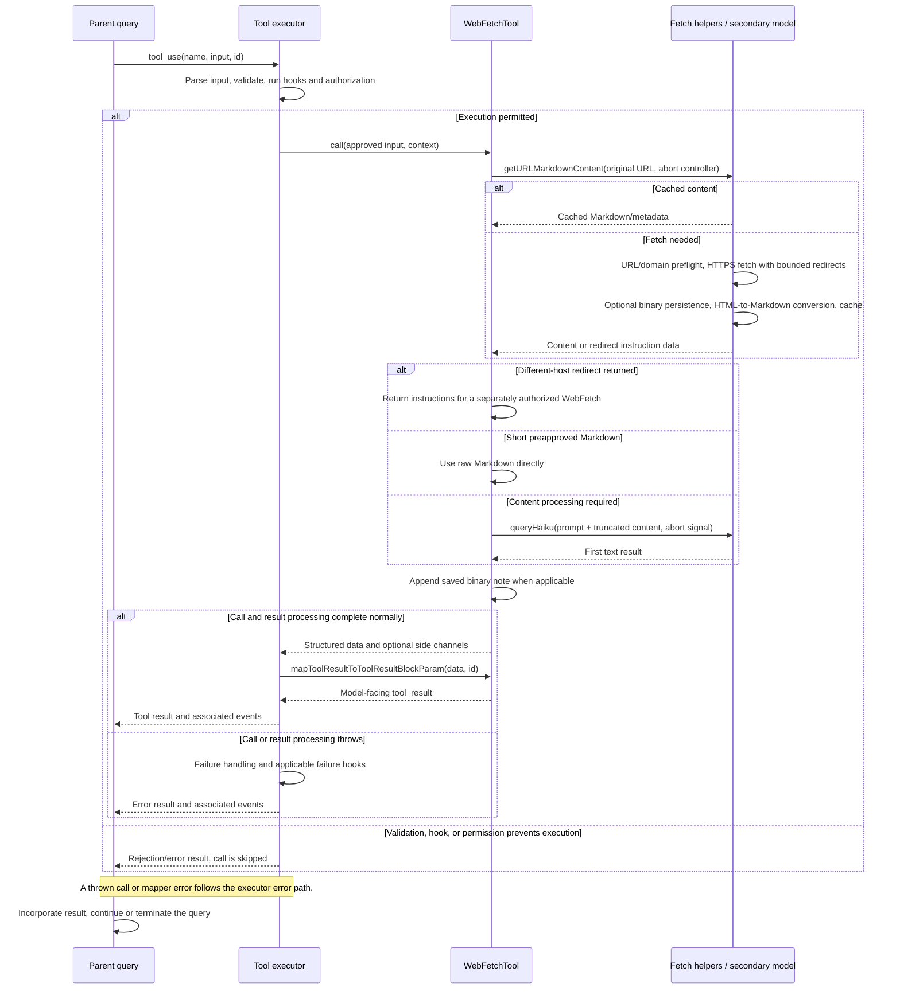

# WebFetchTool Internals

Source: [tools/WebFetchTool/WebFetchTool.ts](../../../../../tools/WebFetchTool/WebFetchTool.ts). Line ranges refer to this recovered source snapshot; symbols are the stable navigation handles.

## Purpose and caller boundary

Fetches URL content, then either returns trusted Markdown directly or asks a secondary model to apply the supplied prompt. Strict input requires a URL and prompt. Output includes bytes, HTTP code/text, result, duration, and original URL. Deferred, read-only, and concurrency-safe, it separates host permission from fetch-domain preflight.

The [shared invocation lifecycle](../../invocation-lifecycle.md) explains registry selection, schema validation, authorization, hooks, result mapping, and exception handling. The sequence below begins with a model tool request and ends at the parent conversation boundary; external services and background workers retain their own lifecycles.

## Source-order walkthrough

### 1. Contract and rule identity (1–64)

The input URL schema validates URL syntax. webFetchToolInputToPermissionRuleContent safe-parses input and derives domain:hostname, falling back to input text on failure. Output bytes normally describe fetched bytes, but redirect responses use the generated instruction-message size.

### 2. Registration and permission ordering (66–181)

Metadata provides host description, activity summary, schemas, and URL/prompt classifier. The tool-specific checker first allows preapproved host/path pairs, then tests exact domain deny, ask, and allow rules, finally asks with a local-settings rule suggestion. This ordering is local to this checker; central policy still wraps it.

### 3. Prompt, validation, UI (183–217)

Prompt consistently includes authenticated/private-URL guidance to avoid schema-description churn. validateInput redundantly parses URL and reports code 1 on failure. UI provides fetch/progress/result rendering.

### 4. Fetch and cross-host redirect result (219–263)

Capture time and call getURLMarkdownContent with the abort controller. A disallowed-to-follow redirect returns instruction text containing original/redirect URL, status, and the original prompt for a future invocation. It does not fetch the new host in this call. Map common redirect codes to status text and return early.

### 5. Direct Markdown or secondary model (265–290)

For a preapproved URL with text/markdown MIME and content strictly shorter than MAX_MARKDOWN_LENGTH, use content directly. Otherwise call applyPromptToMarkdown(prompt, content, signal, noninteractive flag, preapproved flag). This is a separate model request, not another parent query-loop tool round.

### 6. Binary artifact note and result (292–319)

Append saved binary path/size/MIME when fetch conversion persisted raw bytes. Return timing and original URL; the model mapper emits only result. buildSuggestions constructs a local-settings allow rule for the derived domain.

### 7. Fetch dependency (utils.ts:63–479)

The helper validates URL, checks a 15-minute/50-MB URL cache before network, upgrades HTTP to HTTPS, and runs a hostname blocklist check unless settings skip it. Blocked/check-failed outcomes throw. Fetch uses abort signal, 60-second request timeout, 10-MB content cap, and bounded permitted redirects; cross-host redirects are returned for reauthorization. Raw binary can be persisted before UTF-8 decoding, HTML is converted via Turndown, and the converted entry is cached under the original URL.

### 8. Secondary model dependency (utils.ts:484–530)

Truncate content above 100,000 characters, build the secondary prompt, and call queryHaiku with the same signal and web_fetch_apply attribution. Recheck signal afterward and throw AbortError if aborted. Return the first text block or a no-response message. Binary persistence remains supplemental to this summarization path.

## End-to-end sequence

The success arrows after `call` describe normal completion. An exception skips normal result mapping; see the failure boundaries below. Query continuation remains subject to cancellation and turn/budget limits.

## State, failure, and cancellation boundaries

A cached entry can bypass a fresh domain check until cache expiry. The permission prompt and blocklist are separate gates. Network/model failures throw; a cross-host redirect is a normal result. Binary files/cache entries may survive a later model failure. Domain-check timeout is distinct from fetch cancellation, and a returned summary is not an exact copy of the full page.
