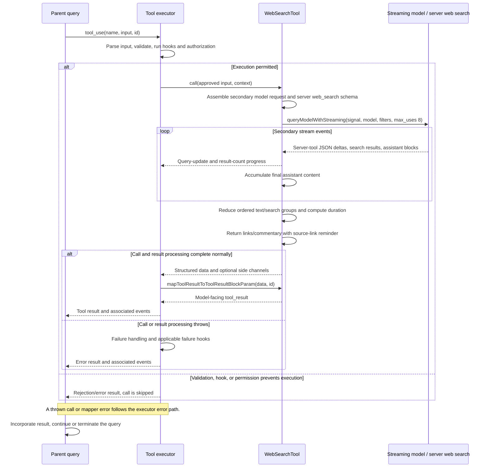

# WebSearchTool Internals

Source: [tools/WebSearchTool/WebSearchTool.ts](../../../../../tools/WebSearchTool/WebSearchTool.ts). Line ranges refer to this recovered source snapshot; symbols are the stable navigation handles.

## Purpose and caller boundary

Runs a secondary streaming model request with the provider’s server-side web_search tool. It does not shell out or use local tool dispatch for each search. Strict input requires a query of at least two characters and optional allowed/blocked domain arrays. Output combines title/URL hit groups with model commentary and elapsed seconds.

The [shared invocation lifecycle](../../invocation-lifecycle.md) explains registry selection, schema validation, authorization, hooks, result mapping, and exception handling. The sequence below begins with a model tool request and ends at the parent conversation boundary; external services and background workers retain their own lifecycles.

## Source-order walkthrough

### 1. Schemas and server tool (1–82)

Search hit groups preserve the server tool_use_id. makeToolSchema uses web_search_20250305, domain filters, and max_uses eight. Output permits strings for commentary and search errors. Progress type is re-exported from centralized types.

### 2. Completed-content reducer (84–149)

makeOutputFromSearchResponse walks content blocks in order. A server_tool_use flushes preceding nonblank accumulated text and exits text mode. Search-result arrays become title/URL groups; error objects are logged and appended as ordinary error strings. Text blocks resume/append accumulation, and trailing text is pushed at end. Other block types are not separately surfaced.

### 3. Availability and permissions (151–231)

First-party and Foundry providers enable the tool; Vertex requires model-name substrings for supported Claude 4 families; other providers disable it. It is deferred, read-only, concurrency-safe, and classifies the query. Tool-specific permission is passthrough with a blanket tool allow suggestion.

### 4. Validation and presentation (233–266)

The UI displays search progress/summary; extractSearchText returns empty because result contents are not rendered in that summary. Validation rejects missing query and simultaneous nonempty allow/block lists. Schema min length normally catches empty input earlier.

### 5. Secondary request assembly (268–310)

Create a single search user message and minimal system prompt. A runtime gate chooses the small fast model, disables thinking, and forces web_search; otherwise use main-loop model/thinking settings. Supply no local tools or MCP tools, only the server search schema, context abort signal, captured permission context, agent definitions/ID, effort, and querySource web_search_tool.

### 6. Streaming accumulators and query progress (312–367)

Assistant events contribute final content blocks. server_tool_use starts set current ID/reset partial JSON. input_json_delta accumulates JSON and regex-extracts a completed query string, then JSON-decodes escapes. A map suppresses unchanged query updates; parse errors from incomplete JSON are ignored. Increment synthetic progress IDs for observed changes.

### 7. Result progress and reduction (369–405)

On a web_search_tool_result start, look up actual query or use original fallback, then emit resultCount (zero for error objects). After stream completion, compute duration and reduce collected assistant content. Raw progress events are not used as the final result source.

### 8. Model mapper (407–436)

Begin with the original query. Skip nullish entries after transcript round-trips; strings become paragraphs, hit groups become JSON links or No links found. Append the Markdown-source-link reminder. No is_error flag is set for embedded search error strings.

## End-to-end sequence

The success arrows after `call` describe normal completion. An exception skips normal result mapping; see the failure boundaries below. Query continuation remains subject to cancellation and turn/budget limits.

## State, failure, and cancellation boundaries

Search service error blocks become ordinary text, while an exception from the streaming iterator propagates. Cancellation is forwarded to the model transport; no local retry loop appears in this tool. max_uses bounds server search uses in the request, not an independently counted local loop. Returned links omit other provider hit metadata, and model commentary is generated content.
